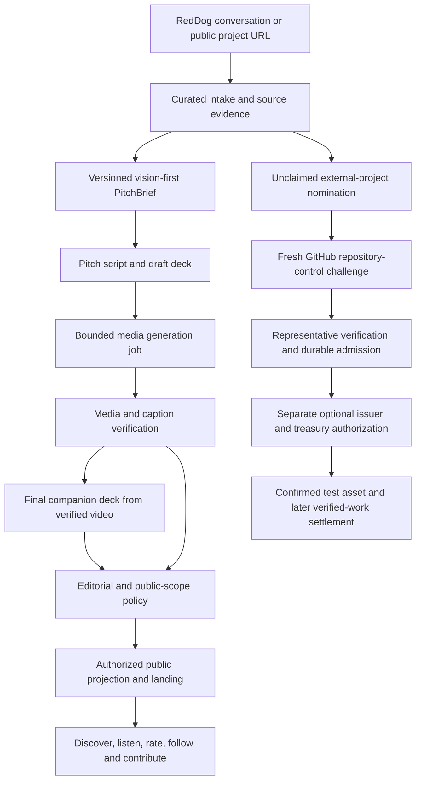

# Preserved historical record: FOUNDUPS_AUTONOMOUS_PITCH_DECK_AND_PROJECT_CLAIM_PLAN.md

> Historical/proposal material. This is not a current acceptance receipt, runtime check or instruction to apply old code. The original dates and claimed outcomes below retain their historical scope.

- Original relative path: `docs/architecture/FOUNDUPS_AUTONOMOUS_PITCH_DECK_AND_PROJECT_CLAIM_PLAN.md`
- Original PC base: `0c81418fe94a7786cfd55f01e138ddc5d510583d`
- Original full file SHA-256: `350ee3155bb696870e1e33023c868732d7c6176b5aa33598af6f6658bc678746`
- Preserved record SHA-256: `350ee3155bb696870e1e33023c868732d7c6176b5aa33598af6f6658bc678746`
- Projection created: `2026-10-30T02:00:12.626831+00:00` (processing time only; not a new observation)
- Comparison reference: `cbef41fbae1ba1105398183e42b008f2e7dfd3dc`
- Publication: proposed; independent auditor acceptance pending.
- Current owner(s): [FOUNDUPS_FX_CHAIN_DELIVERY_PLAN_20261025.md](../../../../../../architecture/FOUNDUPS_FX_CHAIN_DELIVERY_PLAN_20261025.md), [SKILLz.md](../../../../../../../modules/platform_integration/social_media_orchestrator/skillz/foundup_pitch_package/SKILLz.md), [PFMALL_MEDIA_DELIVERY_CONTRACT.md](../../../../../../../modules/foundups/docs/PFMALL_MEDIA_DELIVERY_CONTRACT.md)

Disposition: Archive this design, including its unique shared evidence brief, pitch/deck, durable media jobs, cost limits, repository claim and recovery requirements. Current Skillz is v0.1.3 and remains instruction-only. Carry durable media execution, private asset authorization, claim authority and separate publication grants to these owners; no executor or deployment is implied.

Private host paths and unresolved external identifiers may be omitted only in this projection; raw originals remain in the private custody backmap. External citations are retained as historical references and have not been refreshed. Runtime and commenting remain unverified.

## Historical content

---
title: Autonomous FoundUp pitch, deck and repository claim
date: 2026-10-22
status: proposed_execution_plan_with_local_instruction_skill
related_plan: FOUNDUPS_DISCOVERY_AND_EXTERNAL_PROJECT_ONBOARDING_PLAN.md
---

# Autonomous FoundUp pitch, deck and repository claim

Someone describes an idea or links an existing project to RedDog/0102. The system
should turn that conversation into a vision-first elevator pitch, matching deck
and media package, then make the eligible project discoverable in Play FoundUps
Mall. The person supplies the idea and corrections rather than writing a pitch
or assembling a presentation. Existing-project nomination, community support,
representative verification and optional tokenization fit the same lifecycle.

This extends the [discovery/onboarding plan](FOUNDUPS_DISCOVERY_AND_EXTERNAL_PROJECT_ONBOARDING_PLAN.md)
and [blockchain testnet plan](FOUNDUPS_BLOCKCHAIN_TESTNET_ORCHESTRATION_PLAN.md).
The repository now includes a local instruction skill; the resident conversation
trigger, integrated media worker, ownership verifier and public release pipeline
described below remain engineering work.

## 1. Story order and shared source

Use the existing **OUTCOME -> SOLUTION -> PAIN** model. Outcome is the vision;
Solution is its PoC -> Prototype -> MVP delivery path; Pain is the obstacles to
reaching and implementing that Solution, including existing adoption problems.
"Wouldn't it be great if ..." can open the Outcome without adding a new pillar.

| Existing pillar | Meaning and nested detail |
|---|---|
| OUTCOME | Vision of the desired end state; success signals and non-goals from existing outcome evidence |
| SOLUTION | Reverse-engineered PoC -> Prototype -> MVP path; offering/mechanism, scope, stage gates, evidence and next bounded action |
| PAIN | Obstacles to reaching/implementing the Solution; present adoption problems, affected people, constraints, dependencies, alternatives and evidence |

[WSP 27](../../../../../../../WSP_framework/src/WSP_27_pArtifact_DAE_Architecture.md) defines
the three concepts and outcome-first reverse engineering.
[WSP 109](../../../../../../../WSP_framework/src/WSP_109_FoundUp_Onboarding_Intake_Protocol.md)
defines the OUTCOME/SOLUTION/PAIN artifacts, PoC scope and prototype gates.
[WSP 30](../../../../../../../WSP_framework/src/WSP_30_Agentic_Module_Build_Orchestration.md)
defines the staged build progression. Reuse those records before drafting.
Why, what, how and next steps are supporting detail within the three pillars.
They do not become an alternative five-part presentation framework.

The brief's `narrative` contains only `outcome`, `solution` and `pain` objects.
`solution.poc`, `solution.prototype` and `solution.mvp` separate proposed scope
and gates from current status and evidence. Unknown stages remain unspecified.
The pitch compresses this structure; a deck can expand a pillar across slides.
Keep WSP 109's eight intake artifacts and stage/provenance metadata intact.

Existing project examples already demonstrate this staged solution: the
[Move2Japan path](../../../../../../../modules/foundups/move2japan/docs/04_POC_PROTOTYPE_MVP.md)
defines a question, build scope and success signals at each stage;
[Identity Shield's PoC](../../../../../../../modules/foundups/identity_shield/docs/intake/POC_SCOPE.md)
bounds the smallest proof; and
[Vote/Ballots' prototype gate](../../../../../../../modules/foundups/voteballots/docs/intake/PROTOTYPE_GATE.md)
records requirements before expansion. Use each project's own evidence and
acceptance criteria rather than inventing a generic roadmap.

One versioned `PitchBrief`, derived from curated intake and evidence, feeds all
renditions. Reuse the proposed CampaignBrief fields: project identity, audience,
outcome/solution/pain, CTA, creative requests and provenance. Nest narrative CTA
under Solution rather than introducing another pillar. Add revision/digest,
stage/claim status, source/claim mapping, language, public-data scope, asset/voice
rights and generation budget. Do not create a second competing project registry.

From that brief, the agent writes the finished spoken script, deck slides/notes,
transcript, storyboard and visual prompts. Narration, video, captions and deck
exports reference the same brief revision. A later factual change invalidates
affected renditions until regenerated/reviewed; old versions remain traceable.
The target sequence is script/storyboard -> generated and verified video ->
final companion deck using that video's actual transcript/stills. An early deck
may be a draft/previsualization; it does not prove video generation happened.
Technical QA checks identity, claim consistency, readability, actual duration,
playability and caption timing. Generation success is not editorial acceptance.

Ideas can have compelling future-vision media while being labeled IDEA or
SPECIFIED. Concept visuals and proposed user journeys must not masquerade as a
working demo, verified traction or an endorsement. Preserve honest public stage
and unclaimed attribution for externally nominated projects.

## 2. Connected lifecycle



These are connected records, not one boolean called "onboarded." A nomination
can receive a labeled draft and followers before its representative claims it.
A verified representative can join without a token. A video render never grants
repository, publication or economic authority. Community members can discover,
follow/save, express preferences and offer contributions according to admitted
capabilities. Sponsorship, staking or treasury support requires an explicit asset,
recipient and funding authorization; a Like/Join button never silently spends.

Generation should be autonomous within an existing project/caller scope. Capture
publication policy and provider/cost limits once; reuse a scoped standing grant
for permitted mechanical steps. Escalate missing facts, rights conflicts, spend
limits or revoked authority rather than requesting approval for each draft.

## 3. Local skill and existing implementation seams

The [Codex entry](../../../../../../../.agents/skills/foundup-pitch-package/SKILL.md) routes to
the module-owned [pitch-package Skillz](../../../../../../../modules/platform_integration/social_media_orchestrator/skillz/foundup_pitch_package/SKILLz.md).
It creates a finished local brief/script/storyboard/deck package with explicit
media/render status. This is a prototype instruction skill, without an executor
or WRE registry admission. Its presence does not implement an automated resident
RedDog trigger. The existing campaign operator placeholder remains unchanged.

| Existing donor | Observed capability | Required work |
|---|---|---|
| [WSP 109](../../../../../../../WSP_framework/src/WSP_109_FoundUp_Onboarding_Intake_Protocol.md) and [intake builder](../../../../../../../modules/ai_intelligence/ai_overseer/src/foundup_genesis/intake_packet_builder.py) | Eight-artifact intake contract; structured key/value parser and dry-run validation | Free-form conversation-to-brief integration; preserve current genesis invariants and external-nomination variant |
| [Campaign operator contract](../../../../../../audits/architecture/FOUNDUP_CAMPAIGN_OPERATOR_SKILLZ_PLACEHOLDER_PHASE1.md) | Proposed CampaignBrief/creative-package vocabulary; placeholder, no executor | Reuse vocabulary; keep distribution a separate admitted lane |
| [Veo generator](../../../../../../../modules/communication/youtube_shorts/src/veo3_generator.py) | Provider submit/poll/save and multi-clip code | Current model/API validation, operation persistence, deadline, bounded cost and project-neutral style |
| [Shorts orchestration](../../../../../../../modules/communication/youtube_shorts/src/shorts_orchestrator.py) | Generation and upload methods exist | Avoid legacy create-and-upload path, eager uploader initialization and silent provider fallback |
| [Headless assembler](../../../../../../../modules/communication/headless_video_orchestrator/src/orchestrator.py) | Combines supplied audio and clips | Narration-file adapter, isolated artifacts, timing/format verification |
| [Public projector](../../../../../../../public/f/public_catalog.json) and [Mall contracts](../../../../../../../modules/foundups/docs/PFMALL_MALL_NAVIGATION_CONTRACT.md) | Existing public catalog and media/navigation seams | Explicit approved pitch/deck projection; cross-project listening remains a separate extension |

The scoped inventory did not establish a repository-owned general deck-rendering
backend or stable narration-file contract. The instruction skill can use an
available presentation tool; production rendering needs an admitted adapter.
Use a simple still/animatic rendition or supplied clips before requiring an
expensive cinematic video. Verify current provider capabilities and prices at
execution time; repository model identifiers and per-second constants are not
current availability or spend authority. Relevant current integration docs:
[Google video generation](https://ai.google.dev/gemini-api/docs/video) and
[Google pricing](https://ai.google.dev/gemini-api/docs/pricing).

Dated model recommendation (2026-10-22): evaluate
`gemini-omni-1.1-flash` for the first video adapter. Google currently recommends
Omni Flash for general video generation; its
[Omni guide](https://ai.google.dev/gemini-api/docs/omni) documents video with audio
and the Interactions API. This is a recommendation, not a configured/tested
provider or assurance of account access. The existing Veo worker uses older
`veo-3.0-*-generate-001` identifiers; Google's
[deprecation table](https://ai.google.dev/gemini-api/docs/deprecations) lists
those Gemini API models as retired and Veo 3.1 previews for shutdown on this date.
Retain a separately configured GA Veo route only if the chosen Cloud API,
availability and grant are verified; do not rename a model string and assume
the different API contracts are interchangeable.

Do not construct the legacy ShortsOrchestrator as a general pitch service: its
startup initializes uploader dependencies and can change providers. Its old
create-and-upload path can publish before durable memory is recorded. Reuse
lower-level generation/assembly through a worker with no publishing capability.
The FoundUps unlisted uploader's manifest marker is not an authenticated caller
or signed-manifest verification boundary.

## 4. Durable media worker contract

Accept a brief digest, target formats, allowed provider/model/configuration,
asset rights scope, caller/project grant and bounded budget. Return a durable
job ID promptly so RedDog remains conversational. Persist each stage before
and after attempting its effect:

```text
DRAFT -> VALIDATED -> BUDGET_RESERVED -> SUBMITTING -> GENERATING
      -> DOWNLOADED -> TECHNICALLY_VERIFIED -> EDITORIALLY_APPROVED
      -> PUBLISH_AUTHORIZED -> PUBLISHED
```

Represent `BLOCKED`, `FAILED`, `CANCELLED` and `RECONCILIATION_REQUIRED` explicitly.
Use separate deck/audio/clip/assembly/export child jobs under the shared revision.
Persist attempt/idempotency keys, provider operation ID, reservation, timestamps,
deadline and output digests. Resume polling an existing operation after restart;
retry a download or failed clip without regenerating completed assets. Uncertain
submission goes to reconciliation rather than another paid submission. The same
prompt is nondeterministic; reuse the recorded artifact instead of expecting
regeneration to return identical bytes.

Reserve the quoted maximum before submission, including permitted retries,
audio/images, clip count, duration and resolution. Track estimated, reserved and
observed charges separately, with per-run/project/day and concurrency ceilings.
No silent switch to another provider, credential account, channel or budget.
Missing credentials/capability blocks that rendition while preserving completed
script/deck work. Do not report a prompt, storyboard or still as a rendered video.

Public projection contains only approved stable asset references, transcript,
caption/language/duration, revision, stage and provenance. Keep private source
conversation, prompts, provider credentials, signed download URLs and job control
records outside the public catalog. Public release can be automatic under an
existing scoped publish policy; it is a separate transition from generation.
Persist the publication attempt, upload/resumable-session ID and returned asset
identity before projecting it. If upload acceptance is uncertain, reconcile that
attempt rather than uploading again. A restart after provider acceptance must
not create a duplicate video or catalog entry.

## 5. GitHub code handshake and sash

Anyone may nominate a project URL. To connect an existing project as a verified
representative, provide a generated challenge file the representative adds to
their repository using their own normal GitHub process. FoundUps does not need
write access to that repository for this first verification method.

The sash/badge is the visible status. A static image or copied README badge is
not the verifier. The smallest verifier uses an unpredictable, single-use,
expiring challenge bound by the service to the authenticated claimant, canonical
repository ID, current owner ID, actual default-branch ref, exact path and
`scope=discovery_claim`. A server-signed challenge can carry the same binding;
an opaque nonce with a durable server record is sufficient for the initial PoC.
It is a public challenge value, never a credential or repository secret.

Suggested path: `.well-known/foundups-claim.json`. Issue exact file contents;
the representative need not write any integration code. Verification must:

1. Resolve the submitted repository through GitHub; capture immutable repository
   ID, current owner ID, actual default branch and fork lineage.
2. Resolve that branch to a commit SHA, inspect its tree and require the exact
   path to be a regular file. Reject a symlink, submodule, PR ref, arbitrary tag,
   another fork or merely reachable commit containing a copied challenge.
3. Read the bounded file at that pinned commit; compare all challenge bindings,
   expiry and one-use state. Record commit SHA and blob SHA separately.
4. Recheck repository/owner/default-branch identity and branch-tip SHA before
   admission; retry verification if the tip changed. Atomically
   consume the challenge, and persist the evidence digest and observation time.
   Retries return the same receipt; conflicting claimants require resolution.
5. Show `repository control verified` and current status. A repository-side
   acceptance of a claimant binding is not legal ownership or unlimited issuer
   delegation. Check any required organizational representative role separately.

GitHub's Contents API may resolve symlinks and its file SHA is a blob SHA, so a
content response alone is insufficient for the regular-file/commit checks.
Use [repository metadata](https://docs.github.com/en/rest/repos/repos#get-a-repository),
[Git refs](https://docs.github.com/en/rest/git/refs#get-a-reference),
[Git trees](https://docs.github.com/en/rest/git/trees#get-a-tree), and
[repository contents](https://docs.github.com/en/rest/repos/contents#get-repository-content).

A signed/"Verified" commit badge cannot replace fresh control evidence; GitHub
retains verification records across key changes and the fork network
([commit-signature documentation](https://docs.github.com/en/authentication/managing-commit-signature-verification/about-commit-signature-verification)).
An optional least-privilege GitHub App can later reduce manual steps and supply
ongoing role/webhook evidence; it is not required to nominate or draft media.

Keep historical verification separate from current claim status. Set a policy
recheck deadline; removal, expiry or revocation suspends active status. A rename
can update aliases after immutable-ID verification. A transfer invalidates pending
challenges and suspends grants until fresh verification; a fork needs its own
claim. Do not follow a redirect into a reused old repository name
([transfer behavior](https://docs.github.com/en/repositories/creating-and-managing-repositories/transferring-a-repository)).

The existing GitHub client's reduced Repository model needs immutable IDs and
fork lineage preserved. The read-only permission probe offers a freshness/digest
pattern, but its principal override and missing-expiry behavior are unsuitable
for a public claim endpoint. Reuse the durable nonce-consumption pattern from
the existing intake authentication provider; no verifier was found in the scoped
search. A GitHub claim receipt never grants mint, treasury or governance authority.

## 6. Concatenation with tokens and verified work

Link records by canonical/draft project identity and explicit revision:
intake -> nomination/admission -> brief -> media/deck -> public projection;
claim -> issuer/treasury grant -> confirmed test asset -> verified contribution
allocation -> chain confirmation. Do not merge these into a single status.

The discovery plan's D0/D1 source/deployment and truthful-landing work remains
first. Its M1 becomes autonomous brief/pitch/deck drafting; M2/M4 prove listening
and typed projection; M5 adds the authenticated speech path. External claim
verification fits D4. Optional token creation remains D5, after admission and
economic authorization. Existing WRE accounting/proof/confirmation repairs still
gate rewards. Rendering a pitch produces an artifact receipt, not a funded reward
entitlement or independently verified benefit. No token distribution is triggered
by a nomination, video view, pepper rating or GitHub badge.

## 7. Small implementation slices and acceptance

| Slice | Outcome | Evidence before advancing |
|---|---|---|
| P1 Local instruction skill | RedDog-curated idea becomes vision-first script and matching finished deck | Concrete artifacts, consistent source/stage claims, revision and truthful missing-media statuses |
| P2 Resident draft job | A conversation requests both artifacts and returns a recoverable job | Authenticated input scope, curated public brief, durable status/cancellation and replay without duplicate drafts |
| P3 One media adapter | One bounded narrated/visual pitch with captions | Current provider grant/quote, persisted operation, audio/video/timing QA, retry/restart and cost ceiling |
| P4 Approved Mall package | Catalog/landing can play pitch and open deck | Public schema allowlist, stable assets, policy receipt, anonymous navigation, filtered-order listening and timeout-after-upload/restart recovery without duplicates |
| C1 Nomination/support | Unclaimed candidate can receive followers and contribution offers | No implied endorsement, funding, source execution or token effects |
| C2 Repository handshake | Representative adds generated file and receives verifiable sash status | Exact repository/ref/path, expiry, concurrency, regular-file and stale/transfer/fork cases |
| C3 Optional test token | Admitted representative separately authorizes issuance | Existing D5 testnet, issuer, supply, confirmation and replay gates |

Use existing test files/helpers before adding new suites. Test observable outputs
and state transitions rather than matching promotional wording. Meaningful failure
cases include private-data leakage, unsupported claims, mismatched deck/pitch
revision, missing provider, paid submission timeout, cross-provider fallback,
caption drift, public upload during generation, copied badge, wrong fork/ref,
expired challenge, symlink, transfer and concurrent claims.

WSP 97 execution classification: local instruction drafting and documentation in
this slice; resident autonomous workers later use existing WRE/AgentDB admission.
HoloIndex owner retrieval failed with `HOLOINDEX_AUTHORITY_ROOT_HEAD_MISMATCH`,
`freshness=UNKNOWN`, `index_gap_detected=true`; no reindex. Direct source/contract
reads supplied the donor map. Aspirational campaign/deck/voice wording and older
provider defaults are retrieval noise; live capability is not inferred from them.
The separate PR-cleanup lane and existing dirty runtime/registry files remain
outside this slice.

## 8. Validation in this slice

The initial 0.1.0 Codex skill passed the bundled validator. Its independent local
forward-test used a fictional unadmitted IDEA, BorrowBench, and produced a
finished 141-word pitch, storyboard, six-slide editable PPTX and responsive HTML
deck. All slides were rendered and inspected on desktop; the HTML deck was also
checked at mobile width without observed clipping or external resource requests.
The final brief revision and all ten package artifact hashes were verified; the
first revision was preserved when the output schema was tightened. That fixture
predates the 0.1.1 correction to three-pillar narrative structure; its earlier
rendering checks are not proof of the corrected narrative contract.

The corrected 0.1.1 instruction passed a separate semantic forward-check on a
new BorrowBench draft: exactly three narrative objects; PoC/Prototype/MVP nested
under Solution; the manual PoC remains proposed and later stages unspecified.
Finished narration and four-slide source preserve that structure without
inventing a product or completed stage. The brief digest/revision was verified.
This check did not repeat rendering or provider tests.

Audio/video were correctly `not_generated`, and estimated caption timing remained
unverified. This proves the local instruction workflow on one fixture, not a
resident RedDog/provider/publication integration. Claim and media architecture
received separate read-only reviews; the publication-recovery finding was fixed.
Detailed source snapshots, validation scope and fixture receipt are recorded in
[the research validation receipt](../plans/research/2026-10-22-validation-receipt.json).
