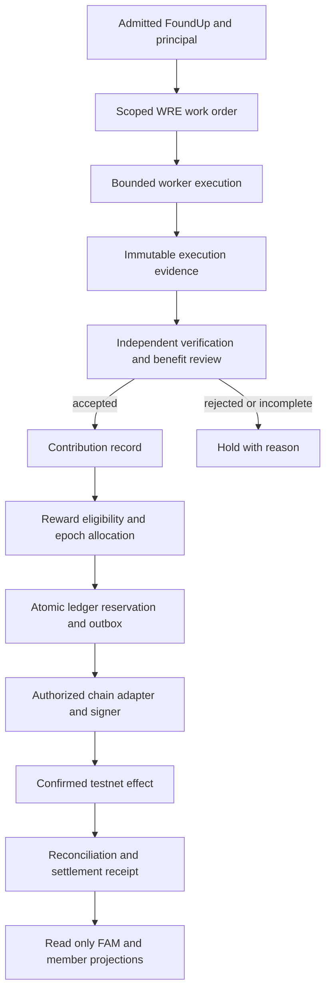

# Preserved historical record: FOUNDUPS_BLOCKCHAIN_TESTNET_ORCHESTRATION_PLAN.md

> Historical/proposal material. This is not a current acceptance receipt, runtime check or instruction to apply old code. The original dates and claimed outcomes below retain their historical scope.

- Original relative path: `docs/architecture/FOUNDUPS_BLOCKCHAIN_TESTNET_ORCHESTRATION_PLAN.md`
- Original PC base: `0c81418fe94a7786cfd55f01e138ddc5d510583d`
- Original full file SHA-256: `74e8c014929ef4886a0982fcd9c9772ebf3a7e173388d7682ef4a0c7cda13d58`
- Preserved record SHA-256: `74e8c014929ef4886a0982fcd9c9772ebf3a7e173388d7682ef4a0c7cda13d58`
- Projection created: `2026-10-30T02:00:12.626831+00:00` (processing time only; not a new observation)
- Comparison reference: `cbef41fbae1ba1105398183e42b008f2e7dfd3dc`
- Publication: proposed; independent auditor acceptance pending.
- Current owner(s): [FOUNDUPS_FX_CHAIN_DELIVERY_PLAN_20261025.md](../../../../../../architecture/FOUNDUPS_FX_CHAIN_DELIVERY_PLAN_20261025.md), [README.md](../../../../../../../modules/foundups/agent_market/README.md), [epoch_ledger.py](../../../../../../../modules/foundups/simulator/economics/epoch_ledger.py), [token_economics.py](../../../../../../../modules/foundups/simulator/economics/token_economics.py), [cabr_flow_router.py](../../../../../../../modules/foundups/simulator/economics/cabr_flow_router.py)

Disposition: Archive the testnet plan as an earlier design, preserving its economic policy decisions and pilot acceptance sequence. Current main has stronger verifier binding, atomic payout initiation and immutable epoch retries, so the older defect list is not a current finding. Funding, signing, aggregate mint policy and durable epoch-budget qualification remain separate owner requirements.

Private host paths and unresolved external identifiers may be omitted only in this projection; raw originals remain in the private custody backmap. External citations are retained as historical references and have not been refreshed. Runtime and commenting remain unverified.

## Historical content

---
title: FoundUps blockchain testnet orchestration plan
date: 2026-10-21
status: proposed_execution_plan
scope: repository_research_and_planning
repository_head: 0c81418fe94a7786cfd55f01e138ddc5d510583d
owners: FoundUps architecture, FAM, WRE, simulator, blockchain adapters
tags: [foundups, blockchain, algorand, testnet, simulator, CABR, UPS, F_i, token_pools]
---

# FoundUps blockchain testnet orchestration plan

P0A implementation (2026-10-22): token-factory selection now rejects unavailable
or invalid requested/default backends without mock fallback, and validates chain
identity across health checks/results. Explicit/default simulation stays labeled.
The [implementation receipt](../plans/research/2026-10-22-token-factory-fail-closed-receipt.json)
records 190 passing module cases and independent review. This closes only P0A;
authorization, accounting, replay/outbox and confirmed settlement remain open.

Fresh [readiness recheck (2026-10-22)](../plans/research/2026-10-22-blockchain-readiness-recheck.md)
confirms the pre-chain authorization/accounting blockers, adds durable payout
retry evidence, and identifies fail-closed backend selection as the first code
slice. Existing passing tests do not constitute release/security clearance.

Continuation (2026-10-22): the [discovery and external-project onboarding plan](FOUNDUPS_DISCOVERY_AND_EXTERNAL_PROJECT_ONBOARDING_PLAN.md)
adds per-FoundUp landing audits, discovery-first Foundups.com, existing-project
admission and an optional Solana Devnet experiment. Its dated source/deployment
observations supplement this snapshot; the settlement correctness gates below
still apply.

The [autonomous pitch/deck and repository-claim extension](FOUNDUPS_AUTONOMOUS_PITCH_DECK_AND_PROJECT_CLAIM_PLAN.md)
connects RedDog intake, vision-first creative artifacts, public discovery and a
GitHub verification sash to the same project identity. Generated content and
repository control do not bypass issuer, contribution-verification or settlement
gates. The local instruction skill is separate from future resident automation.

Start with one admitted FoundUp, one accepted contribution, one versioned reward
policy, and one confirmed testnet transfer. Keep orchestration and evidence off
chain; use the chain for independently observable commitments and settlement.
Expand to a second FoundUp only after replay, restart, identity, and accounting
checks pass.

The repository already contains substantial simulation, FAM task accounting,
registry, and receipt infrastructure. It does not yet demonstrate an end-to-end
path from real orchestrated work to blockchain rewards. Algorand is the strongest
existing design direction, with Bitcoin as a later reserve layer. The current
token factory and Bitcoin anchor path still use mocks. This plan closes those
specific seams rather than replacing the platform.

## 1. Evidence and deliverables

This is a planning snapshot of the current working checkout, including existing
uncommitted changes. It is not a deployment or an assertion that earlier roadmap
completion claims are current. Sources have different authority: WSPs define
protocol requirements, current source defines implemented behavior, tests bound
observed behavior, and vision documents describe intended outcomes.

| Deliverable | Contents |
|---|---|
| [Vision and catalog research](../plans/research/2026-10-21-vision-catalog.md) | FoundUp lists, aliases, source counts, vision and WSP findings |
| [Blockchain research](../plans/research/2026-10-21-blockchain-architecture.md) | Chain decisions, actual adapters, current primary sources, contract gaps |
| [Simulator and economics research](../plans/research/2026-10-21-simulator-economics.md) | Work/reward trace, pool conflicts, simulator boundaries, focused checks |
| [Research coverage](../plans/research/2026-10-21-research-coverage.json) | File identities and the scope of the distributed review |

The distributed review fully read all **110 canonical numbered WSP slots
(00-109)**, including the separate WSP 29 authority addendum, and the relevant FoundUps
vision, architecture, catalog, blockchain, and economics surfaces. Historical
copies, external repositories, raw conversation archives, generated worktrees,
and third-party libraries are not additional canonical FoundUps or proof of
deployment. Coverage records distinguish full reads from targeted source reads.

## 2. FoundUp inventory

The current typed registry contains **16 entities**, of which **5 are typed
`foundup` and 2 `external_foundup`**. There is no verified list of 115 FoundUps in
the reviewed checkout. The WSP master index separately tracks 110 numbered
protocol slots, WSP 00 through 109. These are different inventories.

The following is a read-only projection of
[`foundup_registry.json`](../../../../../../../modules/foundups/foundup_registry.json).
Stages below are registry labels, not new readiness certifications.

| Canonical ID | Name | Registry type | Stage |
|---|---|---|---|
| `gotjunk_001` | GotJunk | foundup | proto |
| `kosei` | Kosei AI Systems | foundup | incubating |
| `magadoom_001` | MAGADOOM | foundup | incubating |
| `antifafm_001` | antifaFM | foundup | proto |
| `shield` | Shield | foundup | incubating |
| `autopost` | AutoPost | external_foundup | incubating |
| `science_swarm_hub` | Science Swarm Hub | external_foundup | proto |
| `voteballots` | Vote/Ballots | skeleton_candidate | incubating |
| `trade` | Trade | skeleton_candidate | incubating |
| `pqn_portal` | PQN Portal | skeleton_candidate | incubating |
| `agent_market` | FAM | infra_service | not assigned |
| `social_twin` | Social Twin | infra_service | not assigned |
| `holoindex_prod_01` | HoloIndex | infra_service | incubating |
| `pfmall` | p.fMALL | platform_layer | not assigned |
| `move2japan` | Move2Japan | access_service | not assigned |
| `simulator` | Economics Simulator | tool_simulator | not assigned |

Other views disagree because they serve different purposes: the video Mall has
14 rows, manifest Mall 4, public catalog 3, and portfolio 3. The module manifest
scan finds 8 manifests plus a separate infrastructure manifest under HoloIndex.
These are overlapping projections, not counts to add together. See the catalog
research for the candidate list and aliases.

Only 6 of those 8 module manifests pass the existing shell validator: HoloIndex
uses an unsupported `INFRA` tier value and Shield lacks the required `name` and
`version` fields. After normalizing known aliases, the typed-registry/video
catalog union contains 23 named records. That is a discovery inventory, not 23
verified ventures; its extra records include umbrella brands and publishing
channels. Geoze and Identity Shield intake are additional unregistered leads.

`token_status: EXISTS` and a ticker such as JUNK or VOTE currently describe
registry/manifest metadata. They do not establish an asset ID, network, deployed
contract, supply, holder balance, or successful transfer.

Before chain enrollment, build one deterministic inventory report from existing
registry and manifest loaders. Report canonical ID, aliases, entity type, source
authority, stage, provenance, and chain deployment evidence separately. Preserve
catalog-only candidates as candidates. Resolve `antifafm`/`antifafm_001` and
`science_swarm`/`science_swarm_hub` explicitly. Do not admit infrastructure or a
skeleton to token issuance merely because a UI lists it.

## 3. Existing architecture and gaps

| Surface | Implemented evidence | Remaining boundary |
|---|---|---|
| FoundUp identity | Typed registry/schema, manifests, read-only loaders | Canonical alias reconciliation and deployment records |
| RedDog and WRE | Scoped work orders, policy/execution/verifier receipts, outcome ratchet | Accepted outcomes have no reward settlement authority |
| BuildPlan swarm | Deterministic planning, queue/lease simulation, evidence shapes | Executor and worker queue explicitly remain scaffolds |
| FAM | Task/proof/verification/payout records and persistent adapters | Ledger `PAID` is not chain confirmation; adapter parity gaps |
| CABR/pAVS | Receipt intake and review consensus components | Review acceptance is not independent benefit verification or payout readiness |
| Simulator | Pools, epoch accounting, flow router, anchors, market scenarios | Generated proofs, mock confirmations, and economic hypotheses |
| Token factory | Chain abstraction and mock deployment | No Algorand backend; unsupported chain can fall back to mock |
| Blockchain domain | Legacy blockchain/token sketches | No production asset/settlement contract found in reviewed surfaces |
| Member surfaces | Discovery and selected public PWAs | General wallet gate and stakeholder interior remain targets |

Key source boundaries:

- [`build_plan_executor.py`](../../../../../../../modules/foundups/agent/src/build_plan_executor.py)
  blocks real execution; its readiness fields remain false.
- [`build_plan_swarm_queue.py`](../../../../../../../modules/foundups/agent/src/build_plan_swarm_queue.py)
  models assignments without real worker dequeue or reward authority.
- [`pavs_verification_seam.py`](../../../../../../../modules/communication/moltbot_bridge/src/pavs_verification_seam.py)
  returns `ACCEPTED_FOR_REVIEW`; it performs no cryptographic verification,
  token issuance, or reward allocation.
- [`reddog_verified_outcome_ratchet.py`](../../../../../../../modules/infrastructure/wre_core/src/reddog_verified_outcome_ratchet.py)
  records independently reviewed outcomes but explicitly does not settle rewards.
- [`token_factory.py`](../../../../../../../modules/foundups/agent_market/src/token_factory.py)
  registers a mock backend. Testnet requests must eventually fail closed if the
  requested real backend is unavailable.

Reuse these boundaries. A work-order policy receipt, queue completion, model
answer, passing awakening check, or draft PR is insufficient reward evidence.
Cryptographic provenance and task acceptance must be established independently
of self-reported confidence, coherence, token use, or model agreement.

### Correctness defects that block chain integration

The focused probes in the economics and blockchain reports reproduce these
failures without network writes. They need regression cases and repairs before
their data is admitted to a real adapter:

| Defect | Required gate |
|---|---|
| A Merkle proof can retain a valid stored leaf hash after its amount or participant fields change | Recompute the leaf from the claimed beneficiary, amount, asset, epoch and policy; verify that exact leaf against the committed root |
| Reusing an epoch key overwrites proof maps while chain validity still reports true | Immutable epoch content; exact replay allowed, conflicting reuse rejected; old proofs remain independently verifiable |
| The simulator can mint 21 million tokens and then create additional staked F_i | One issuance/release accounting boundary for every creation path; tests sum liquid, staked and reserved units |
| Persistent FAM verification omits the in-memory verifier role check | Same principal/role, independence and tenant checks across adapters |
| Persistent payout labels a task PAID with an INITIATED record and no transaction reference | Separate accounting acceptance, reservation, submission, confirmation and reconciliation |
| Repeated router calls each take a new percentage of treasury within the same epoch | Persist one epoch-wide budget/consumption counter; reserve against that budget atomically |
| Anchor idempotency accepts changed content for an existing FoundUp/epoch, and accepts malformed digest text | Content/network-bound identity; strict digest schema; conflicts fail closed |
| A requested Algorand backend resolves to mock | Explicit real-mode capability and network admission; no silent downgrade |

Existing happy-path tests can pass while these cases fail. Repairing them is a
prerequisite, not a reason to relabel the simulation as blockchain readiness.

## 4. Chain direction

Use **Algorand as the proposed first testnet rail**, following WSP 26,
[`FOUNDUPS_BTC_RESERVE_TOKEN_ARCHITECTURE.md`](../../../../../../architecture/FOUNDUPS_BTC_RESERVE_TOKEN_ARCHITECTURE.md),
and the existing Algorand contract designs. Retain the chain adapter so FAM and
reward policy do not depend on Algorand SDK types. Preserve Bitcoin as the
designed reserve layer and off-chain agents as the execution layer.

The legacy Polygon Mumbai documents, in-memory proof-of-work chain, and
Hedera/EVM/Solana enum names are not evidence that those integrations are built.
The blockchain research records current official Algorand network, asset, and
post-quantum account documentation. Native Falcon account support must be
verified for the specific wallet and transaction path; an ASA does not make
every holder's signing path post-quantum secure.

The current [Algorand post-quantum account documentation](https://dev.algorand.co/concepts/accounts/post-quantum/)
distinguishes native Falcon accounts from ordinary accounts and does not provide
native post-quantum multisig. Select the pilot signer based on the actual supported
account path and transaction cost. Do not weaken custody controls to claim PQ
coverage. See the blockchain report for dated official-source verification.

The [ASA documentation](https://dev.algorand.co/concepts/assets/overview/)
requires receiver opt-in and additional minimum account balance. Budget native
ALGO for opt-ins, application storage and fees separately from the test reward
asset. Algorand's [finality model](https://dev.algorand.co/getting-started/why-algorand/)
uses final block inclusion; recovery should track actual confirmed effects and
endpoint observation lag rather than copying the BTC mock confirmation counter.

Use local chain tooling before public testnet. Pin the network identity, SDK,
compiler, node/indexer dependencies, and deployable artifact hashes. Testnet and
MainNet credentials, app IDs, asset IDs, and stores must be distinct. Test assets
carry no promise of BTC backing, redemption, market liquidity, or future
mainnet conversion.

For the first confirmed transfer, a capped test ASA treasury transfer is enough
to exercise the adapter and confirmation/reconciliation path. This has a trusted
test operator and does not prove autonomous contract enforcement. A separate
milestone must move authorization and replay protection into an audited app
before any autonomous reward-settlement claim. Choose a direct bounded transfer
first; introduce batch claims only when measured volume justifies them.

## 5. Economic decisions to settle before implementation

### Token identities and beneficiaries

Keep UPS, per-FoundUp `F_i`, and proposed investor `I_i` distinct. WSP 101
distinguishes human UPS participation from agent `F_i` work recognition; the
vision blueprint also distinguishes compute awards, rewards, and dividends.
An agent ID, the principal it serves, an eligible beneficiary, and the address
holding a token are separate identifiers.

Define a versioned test policy that specifies, for each contribution category,
the asset awarded, beneficiary eligibility, account owner, and allocation basis.
For an agent contribution, use an operator-controlled test wallet and retain
agent/principal attribution in the ledger, consistent with the current
entitlement contract. Do not silently issue an agent wallet or convert `F_i` to
human UPS. Admit human engagement as its own evidenced contribution category.

The initial pilot should demonstrate one category at a time. First settle a
verified agent contribution in a test `F_i` asset; next exercise separately
defined human test-UPS participation. Their tests must show which person or
operator receives each allocation and why. Neither test establishes a production
economic entitlement.

### Pool conflicts

| Source | Allocation | Required interpretation decision |
|---|---|---|
| WSP 26, pool/epoch model | 60% Un, 16% Dao, 4% Du, 16% network, 4% fund | Supply/epoch budget, eligibility, and activity rules |
| WSP 29, task flow | 50% claimer, 15% verifier, 10% creator, 15% FoundUp treasury, 10% ecosystem | UPS task-flow budget and authorized recipients |
| Simulator CABR path | 70% worker, 20% FoundUp treasury, 10% network | Simulation policy inconsistent with WSP 29 if applied to the same flow |

Do not average these formulas or apply them serially to the same amount. First
identify the asset, funding source, release event, denomination, and eligible
population for each. If they govern different budgets, state that explicitly and
prove they cannot double count. If they govern the same budget, select one
canonical policy and amend its owning specification and implementation together.
Freeze the accepted policy hash for each epoch; later policy changes affect
future epochs only.

WSP 26's later Du pool rules distinguish passive stakers, active Dao task
contributions, and Un engagement. An orchestrator earns only through an admitted,
verified coordination contribution. Merely dispatching or multiplying workers
does not create a new award. Separate worker and independent verifier rewards;
prevent self-verification and colluding identities from satisfying a quorum.

### Reserve, supply, and decay

Resolve the contradictory genesis rates: WSP 26 states 100,000 UPS per BTC,
while the April reserve memo states 1 UPS per satoshi, or 100,000,000 UPS per
BTC. That is a factor of 1,000. Neither rate is safe to infer into a contract.
Also reconcile floating reserve coverage, permanent BTC retention, and the
proposed external exit path; reserve backing is not proof of redeemability.

Agree on base units, decimals, maximum supply, release schedule, rounding,
circulating versus locked balances, and fee payer. Use integer accounting at
settlement boundaries. A 21 million `F_i` design cap is not permission to release
the entire supply at genesis.

UPS demurrage requires an explicit authoritative balance model; an ordinary ASA
transfer does not implement the simulator's decay rules. Specify whether a
contract ledger, checkpointing, or wrapped balance interface owns decay before
exposing a production balance. Decide what the wallet displays and how transfers
and rounding interact with decay. Keep the first transfer policy simple and
explicitly outside a full decay/economy claim.

The existing `I_i` bonding-curve freeze remains a separate gate. Keep that path,
guaranteed-return scenarios, reserve custody, bridges, and real-value exchange
outside the testnet contribution pilot. Repository assertions that a token is
not a security are project positioning, not a verified legal classification.

## 6. Work to reward orchestration



The signer accepts only an admitted settlement authorization. It does not accept
free-form RedDog messages, arbitrary addresses supplied by workers, or a mutable
web catalog entry. FAM owns task and allocation accounting; WRE owns execution
authority; verifiers attest task outcomes; the chain adapter submits and observes
effects. These authorities must remain distinct.

### Proposed records

These are design requirements for extensions of existing schemas, not new
implemented public APIs.

| Record | Required binding |
|---|---|
| Contribution | schema version, FoundUp/tenant ID, work-order/task ID, execution attempt, actor and principal, artifact/evidence digests, source authority and revision, acceptance criterion, verifier identities/results |
| Beneficiary binding | principal/agent relationship, wallet ownership challenge, chain/network identity, permitted asset/category, expiry/revocation and version |
| Allocation | contribution digest, policy/epoch ID, category/pool, integer amount/asset/decimals, beneficiary binding, funding source, verifier decision, unique allocation key |
| Settlement authorization | allocation set digest, exact network/app/asset/treasury, totals and fees, expiry, authorized issuer, policy version, signer capability |
| Chain receipt | authorization/allocation IDs, transaction/group ID, confirmed round, observed asset effect, network identity, artifact version, reconciliation result |

Hash domain-separated canonical encodings. Persist the allocation and its outbox
entry in one database transaction with unique constraints. The replay key must
bind contribution, policy, epoch, asset, and beneficiary; retry attempt numbers
must not produce fresh economic awards for the same accepted contribution.
Also enforce one consumed-source key per accepted contribution and authorized
award category, independent of epoch, policy version or wallet address. Moving a
contribution into a later epoch or rebinding its beneficiary cannot create a
second award. Any additive category needs its own explicitly admitted basis.

Use an explicit state model:

```text
EXECUTED -> REVIEW_PENDING -> VERIFIED -> ELIGIBLE -> ALLOCATED
         -> SUBMISSION_PREPARED -> SUBMITTED -> CONFIRMED -> RECONCILED
```

Rejection, hold, expiry, revocation, failed submission, and disputed allocation
need separate states/reason codes. Legacy FAM `PAID` must not be displayed as
`CONFIRMED` without a matching chain receipt. An epoch hash anchored on chain
proves a commitment exists; it does not prove that beneficiaries were paid.

### Retry and failure handling

Persist the signed transaction bytes or their safe recovery reference and the
transaction ID before broadcast. If submission times out, query the known ID and
observe expiry before considering a replacement; an ambiguous RPC response is
not permission for a second payment. Contract-level consumed-allocation state is
required for autonomous replay protection beyond the trusted operator pilot.

Process duplicate and reordered events idempotently. Restart workers after
allocation, signing, broadcasting, and confirmation during tests. Reconcile
ledger reservations, actual confirmed transfers, treasury balances, pending
outbox items, and recipient opt-in state. An unavailable indexer or missing
round data means pending observation, not payment failure or success. Network
resets require a new deployment namespace and must never reuse old claims.

Keep evidence bodies and private work off chain. Publish digests and minimal
allocation commitments. Per-FoundUp authorization and data isolation must hold
even when infrastructure, signer processes, or operator wallets are shared.

## 7. Implementation sequence and exit criteria

Each row is a bounded implementation slice. Finish its evidence gate before
starting a dependent row. New deployable blockchain logic belongs in the
blockchain domain; FAM and WRE consume adapters instead of importing chain SDKs
throughout the control plane.

| Slice | Owner and reuse | Depends on | Exit evidence |
|---|---|---|---|
| T0 Inventory and policy lock | Architecture; typed registry/loaders, WSP 26/29/101 | This review | Reproducible portfolio projection; aliases resolved; one test policy binds asset, pools, units, beneficiary and funding rules |
| T1 Accounting and proof correctness | Simulator + FAM | T0 | Reproduced proof/epoch/cap defects repaired; same policy and integer vectors in simulator/runtime; mock evidence stays separate |
| T2 Contribution admission | WRE receipt/verifier owners + FAM | T0 | One real accepted bounded work result maps to one durable contribution; tampering, self-review, wrong tenant and retry duplication fail |
| T3 Allocation and recovery | FAM persistent pipeline | T1, T2 | Atomic reservation/outbox; role parity; PAID/confirmed distinction; replay/restart preserves totals; anchor conflicts rejected |
| T4 Algorand adapter on local network | Blockchain adapter + token factory | T0; integrates T3 | Explicit real backend; no mock fallback; asset creation/opt-in/transfer/confirmation fixtures; deterministic artifact and deployment manifest |
| T5 One FoundUp on public TestNet | Operations + signer + verifier | T3, T4 | One genuine contribution produces one authorized transfer and independently checked confirmation; no real reserve/economic claims |
| T6 Contract enforced pilot | Blockchain + independent reviewer | T5 | App enforces issuer authority, allocation replay protection, supply/budget bounds and pause; direct operator-transfer trust removed from settlement claim |
| T7 Second FoundUp and human category | FAM + identity + member read model | T6 | Cross-tenant substitution blocked; separate human eligibility policy; two isolated budgets and auditable wallet histories |
| T8 Production design gates | Architecture, custody/security/legal/operations owners | Sustained T7 evidence | Reserve model, decay, economics, independent contract review, incident recovery and production admission separately satisfied |

The first product FoundUp should be selected from admitted registry entries based
on a bounded measurable contribution and an available verifier. GotJunk is a
reasonable initial candidate because its registry stage is `proto`; that label
alone does not make it eligible. A synthetic test tenant may exercise mechanics
in local testing but cannot stand in for the T5 real-work acceptance gate.

T0 is the next engineering preparation slice. T4 can research tooling in
parallel with T1/T2, but settlement integration must wait for T3. Do not issue
assets for every catalog row or create a new scheduler/registry to begin this
work. Use existing WRE queue and FAM authority contracts.

### Suggested bounded work packet

For each slice include: exact FoundUp and repository authority; input artifact
hashes; acceptance criteria and independent verifier; file ownership; dependency
receipts; allowed effects and budgets; required tests; output receipt schema;
retry/expiry policy; rollback or pause behavior; and updated module memory.
Model choice is a runtime capability decision, not a fixed architectural role.
Use deterministic tools for identity, accounting, signature and policy checks.
Models may propose or assess evidence; their prose cannot authorize transfers.

## 8. Simulator and testnet acceptance scenario

Use one fixed seed, one FoundUp, two attributed worker identities, three distinct
principal-bound independent verifiers, and operator-controlled test wallets.
The quorum follows WSP 29's consensus gate; a single-verifier transport fixture
must remain explicitly below Proof-of-Benefit consensus. For example, configure a
10,000-base-unit test budget; the exact split comes from T0, not a new economic
formula in this plan. A second fixture covers human participation separately.

1. Admit the FoundUp and wallet bindings. Record network/genesis identity, asset
   decimals, treasury funding, opt-ins, policy hash, code revision, seed and
   deployment artifact hashes.
2. Execute one bounded work order and one deliberately invalid work order.
   Independently verify the accepted result against its observable criterion.
   Preserve rejected/dry-run evidence without awarding it.
3. Allocate the accepted contribution through the shared policy. Freeze the
   beneficiary set before the epoch cutoff; reject policy edits within that
   epoch. Simulator and FAM must compute identical integer amounts.
4. Submit the admitted allocation to the local network, then public TestNet.
   Observe the matching confirmed round and actual asset effect. Independently
   reconcile the beneficiary and treasury deltas, fees and residual budget.
5. Repeat input events, restart the process at each durable boundary, inject a
   broadcast timeout, and replay the same authorization. The aggregate reward
   remains unchanged.
6. Attempt wrong-tenant IDs, wrong network, wrong asset, forged acceptance,
   revoked/changed wallet binding, missing opt-in, insufficient funds, stale
   authorization and an over-budget epoch. Each must hold or reject with a
   specific reason and no unintended transfer.
7. Export a machine-readable run manifest and reconciliation report with links
   to public testnet effects. Mark simulator-only, locally observed, publicly
   confirmed, and unresolved evidence distinctly.

Required invariants:

- No reward without independently accepted work and eligible beneficiary.
- No double reward per consumed contribution/category, including across epochs,
  policy changes, retries and beneficiary rebindings.
- Sum of allocations plus explicit residual equals the admitted budget.
- Allocations never exceed released supply or reserved treasury capacity.
- Contract/base-unit arithmetic matches runtime and simulator rounding.
- Accepted proofs cannot cross tenants, networks, assets or policy versions.
- Anchoring, review acceptance and ledger payout labels never imply settlement.
- Principal revocation and wallet reassignment have deterministic cutoff rules.
- A paused signer/app prevents new settlement while observation/reconciliation
  can continue.

Run a second phase of simulations for collusion/Sybil attempts, unequal compute
costs, verifier scarcity, beneficiary churn, demurrage and liquidity shocks only
after the basic allocation model agrees. Report scenario assumptions; forecasts
and mocked return multipliers are not observed economic performance.

## 9. Validation and current limitations

The parent review ran the existing executor/queue boundary tests with isolated
temporary/database paths and bytecode/pytest cache disabled:

```text
python -B -m pytest modules/foundups/agent/tests/test_build_plan_executor.py
  modules/foundups/agent/tests/test_build_plan_swarm_queue.py
  -q --basetemp <isolated-test-root>/pytest -p no:cacheprovider
Result: 59 passed in 0.37s
```

This verifies their current simulation/blocking contract. The simulator/FAM lane
also recorded 152 passing focused tests with two pytest configuration warnings;
the blockchain lane recorded 16 passing mock tests. A separate legacy blockchain
suite failed collection because its package initializer contains NUL bytes.
Exact commands, isolation and the additional defect probes are in the research
reports. The passing results do not prove
live work attribution, cryptographic verifier admission, reserve custody or
on-chain payout. No chain transaction or deployment was performed in this
planning slice.

HoloIndex retrieval returned `HOLOINDEX_AUTHORITY_ROOT_HEAD_MISMATCH`:
`ok=false`, `freshness=UNKNOWN`, `index_gap_detected=true`, authority HEAD
`a519f0ad758618c5d82f0ebf8b48a3c4a0eae7f0` versus working HEAD
`0c81418fe94a7786cfd55f01e138ddc5d510583d`. Direct repository discovery was used
and no query-side reindex occurred. Route recovery through the existing governed
HoloIndex owner/WRE/CI maintenance path before automated implementation depends
on current semantic retrieval.
The [exact retrieval result](../plans/research/2026-10-21-holoindex-retrieval-result.json)
is retained with the research.

Retrieval evaluation: initial broad filename searches included virtualenv and
worktree noise; subsequent searches were scoped to owning repository surfaces.
Tier-0/module docs, newer source and tests were prioritized over historical
completion claims. Duplicate WSP mirrors and catalog projections were treated
as copies, not extra entities. Source staleness is material: the active slice
ledger and several roadmaps predate later code, so their open/closed labels were
not accepted as current without source evidence. Missing module artifacts are
recorded in the research reports and belong to the owning implementation slice.

## 10. Completion criteria for the first pilot

The first pilot is complete when an admitted FoundUp has one real independently
accepted contribution, a policy-bound allocation, a confirmed testnet effect to
the correct operator-controlled beneficiary, and a reconciled ledger that
survives replay and restart without paying twice. A second reviewer must be able
to reconstruct that result from the work, policy, allocation, and chain receipts.

That result makes the next layer concrete: contract-enforced settlement and a
second isolated FoundUp. Reserve backing, exchange, staking economics, broad
portfolio enrollment, and mainnet release remain separate measured milestones.
