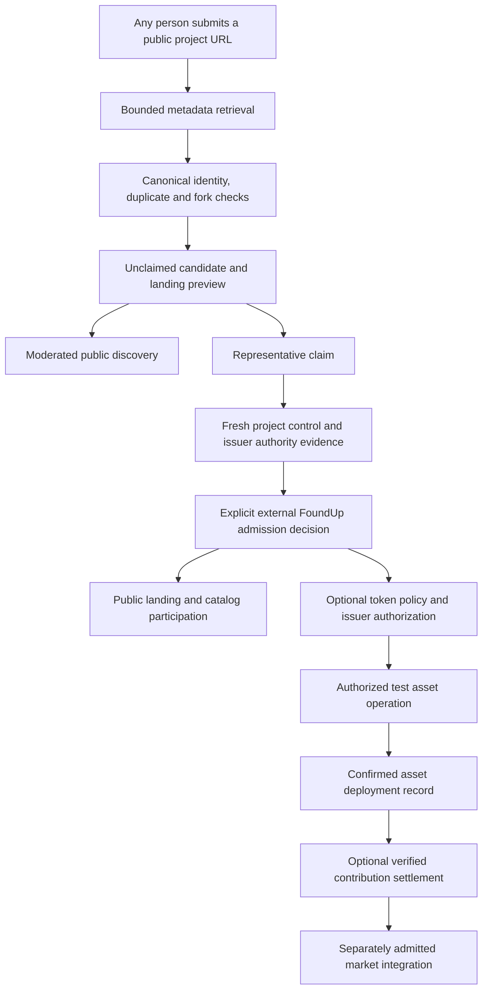

# Preserved historical record: FOUNDUPS_DISCOVERY_AND_EXTERNAL_PROJECT_ONBOARDING_PLAN.md

> Historical/proposal material. This is not a current acceptance receipt, runtime check or instruction to apply old code. The original dates and claimed outcomes below retain their historical scope.

- Original relative path: `docs/architecture/FOUNDUPS_DISCOVERY_AND_EXTERNAL_PROJECT_ONBOARDING_PLAN.md`
- Original PC base: `0c81418fe94a7786cfd55f01e138ddc5d510583d`
- Original full file SHA-256: `20ff364d309240e3768d56d5b9e95fe2d1909a607923a0d995b996894f783960`
- Preserved record SHA-256: `20ff364d309240e3768d56d5b9e95fe2d1909a607923a0d995b996894f783960`
- Projection created: `2026-10-30T02:00:12.626831+00:00` (processing time only; not a new observation)
- Comparison reference: `cbef41fbae1ba1105398183e42b008f2e7dfd3dc`
- Publication: proposed; independent auditor acceptance pending.
- Current owner(s): [ROADMAP.md](../../../../../../../modules/foundups/pfmall/ROADMAP.md), [intake_host.py](../../../../../../../modules/foundups/pfmall/intake_host.py), [FOUNDUPS_FX_CHAIN_DELIVERY_PLAN_20261025.md](../../../../../../architecture/FOUNDUPS_FX_CHAIN_DELIVERY_PLAN_20261025.md), [PFMALL_MEDIA_DELIVERY_CONTRACT.md](../../../../../../../modules/foundups/docs/PFMALL_MEDIA_DELIVERY_CONTRACT.md)

Disposition: Archive discovery/onboarding design and retain the unique discovery, voice-driven mall selection, no-rebuild project admission and proof requirements. Current intake host is bounded draft intake; it does not establish deployed claim authority, signer funding, video generation or permission to publish. Public media paths are not private storage.

Private host paths and unresolved external identifiers may be omitted only in this projection; raw originals remain in the private custody backmap. External citations are retained as historical references and have not been refreshed. Runtime and commenting remain unverified.

## Historical content

---
title: FoundUps discovery and external project onboarding
date: 2026-10-22
status: proposed_execution_plan
repository_head_at_start: 0c81418fe94a7786cfd55f01e138ddc5d510583d
scope: landing_audit_media_discovery_and_onboarding_architecture
related_plan: FOUNDUPS_BLOCKCHAIN_TESTNET_ORCHESTRATION_PLAN.md
tags: [PlayFoundUps, pFMALL, discovery, pitch_media, RedDog, landing_pages, external_projects, GitHub, tokenization, Solana, Algorand]
---

# FoundUps discovery and external project onboarding

Foundups.com should open into **Play FoundUps Mall**, a public discovery grid.
The current explanatory homepage belongs under a real `/about/` route. Each
admitted FoundUp should have a truthful public landing page that links back to
the Mall, explains its purpose and current evidence, and offers the appropriate
next action. Projects should be able to join from an existing repository without
rebuilding or relocating their product through FoundUps.

The first implementation should complete and expose the existing public catalog
and page renderer. The external-project path then extends existing intake,
registry, and token-factory boundaries. It does not require a new general
exchange, scheduler, blockchain, or website framework.

Anyone may nominate a public project. Autonomous discovery and drafting can
follow immediately; project-endorsed token issuance requires separately verified
project/issuer authority and an explicit economic policy. Once those bindings
are established, bounded automation can carry out the approved workflow without
asking for approval at every mechanical step.

## 1. Audit evidence

| Artifact | Purpose |
|---|---|
| [Landing page audit](../plans/research/2026-10-22-landing-page-audit.md) | Per-entity local and deployed coverage, missing links, source/readiness drift |
| [Landing audit records](../plans/research/2026-10-22-landing-page-audit.json) | Machine-readable rows for the registered inventory and additional candidates |
| [External intake architecture](../plans/research/2026-10-22-project-intake-architecture.md) | Existing intake/auth/registry surfaces, ownership gaps, module reuse |
| [Tokenization research](../plans/research/2026-10-22-external-project-tokenization.md) | Current Solana mechanics, DAO2 evidence, chain and trading distinctions |
| [Parent public route observations](../plans/research/2026-10-22-public-route-observations.json) | Anonymous HTTP status, content type, body identity and source/deployed distinction |
| [Blockchain orchestration plan](FOUNDUPS_BLOCKCHAIN_TESTNET_ORCHESTRATION_PLAN.md) | Verified-work allocation, accounting repairs, confirmation and reconciliation gates |

The registered inventory remains 16 mixed entities: 5 `foundup`, 2
`external_foundup`, 3 `skeleton_candidate`, and 6 shared services/platform/tools.
The current source video catalog has 14 rows; the live video catalog observed in
this audit has 13. The live homepage says "Browse 15 FoundUPS." None of these is
evidence for 115 admitted ventures. The directory must display counts derived
from the selected population and label candidates separately.

A connected GitHub inventory returned 20 connector-visible FOUNDUPS repositories,
16 public and 4 private. This is an access-scoped repository observation, not a
complete venture inventory. Several repositories may serve one venture, and one
repository may host several capabilities. Private repository identities are not
inputs to the public catalog.

### Current source versus current deployment

| Surface | Checked-out source | Anonymous deployed observation on 2026-10-22 |
|---|---|---|
| `/` | Explanation, prototype animation, sign-in/invite gateway | HTTP 200; explanation/gateway, not a project tile directory |
| `/about` | No dedicated about file established | HTTP 200 with exactly the same body hash as `/`; fallback, not a completed route migration |
| `/f/` | Public renderer now fetches only `/f/public_catalog.json` | Older deployed renderer; still refers to member-era catalog sources |
| `/f/public_catalog.json` | Valid JSON projection with 3 eligible entries | HTTP 200 **HTML**, identical body hash to `/f/`; not a deployed JSON catalog |
| `/member/` | Member shell and existing admission flow | Shell HTML observed; authentication was not attempted or bypassed |
| HoloIndex dedicated `/f/.../` | Explicit small stub, distinct from generic renderer | Stub observed; no equivalent functional public PoC established |

The local projector and portfolio validators both pass with zero violations.
All 42 existing projector tests pass. This proves the local three-entry
projection follows its current filter; it does not prove complete landing
coverage or successful deployment. Do not recreate the projector or repeat the
older audit's now-stale assertion that source wiring is still missing.

Identical generic HTML across `/f/{id}` routes is normal for a client renderer
and cannot prove that each project resolves. Validate the returned catalog,
identity-specific rendering, links and application behavior separately. A 200
response serving a fallback page or an app's boot HTML is not a working PoC.

## 2. Landing page requirement

Every admitted product FoundUp gets one canonical public landing at
`/f/{foundup_id}`. Public narrative may be a limited teaser for an otherwise
private project; this does not expose private source, member data, or economic
participation. Shared infrastructure may have an explicitly scoped public
explanation where intended, without exposing its protected runtime.

| Required content | Acceptance condition |
|---|---|
| Identity and purpose | Canonical name/ID, problem, intended outcome, concise solution; no invented ownership |
| Current stage | Idea/specification, internal PoC, public demo, prototype and production evidence remain distinguishable |
| Evidence | Links to actual docs, release/source and demonstration where public; date and tested scope for claims |
| Source and affiliation | Public repository or project site, verified maintainer/issuer status; no private-repo leakage |
| Primary action | Read proposal, view public demo, visit project, contribute or enter member capabilities according to actual availability |
| Mall connection | Visible `Back to Play FoundUps Mall` link that works for anonymous visitors and preserves browse context |
| Token status | None/deferred, test deployment, or verified production asset; network and mint/asset ID only when observed |

A landing page is a minimum public explanation/proof-of-concept artifact. It is
not evidence that the product itself, its autonomy, token economy or PoC works.
For example, a module may have an internal PoC but no public demo; show both facts
without changing its maturity based on a page's existence. The landing audit
records registry/module disagreements, including Vote/Ballots and Kosei.
GotJunk's registry summary also describes a different offering from its current
README. Generated copy must preserve source provenance and be reviewed against
current product evidence; publishing stale metadata at scale would amplify drift.

The checked-out source generic renderer resolves only the three public-projection entries;
the dedicated HoloIndex stub overrides that generic path. Extending coverage
requires narrative/status evidence and a publishing decision for each product.
Do not mark all 16 entities portfolio-ready to make them appear.

### Visibility and selection

`portfolio_ready`, featured selection, public discovery, application access,
project claim, and token deployment are separate axes. The current projector
uses portfolio eligibility for the public directory, which excludes otherwise
registered projects. Introduce an explicit public-discovery policy in the
existing schema/projector; retain portfolio eligibility as an editorial view.
Do not use a layout badge as access control or economic authorization.

Remove token-looking fallbacks such as dollar-prefixed IDs when no real token
exists. A planned ticker may be shown as planned metadata; it must never turn
into a price, market cap or on-chain asset claim. HoloIndex's token-deferred and
dual-identity status needs particular care.

## 3. Discovery-first Foundups.com

Use one public catalog and one presentation contract for `/` and `/f/`.
The homepage should open directly into project tiles, with search/category/stage
filters and explicit navigation. Keep the richer member session, worker and
wallet surfaces separately admitted.

```text
FOUNDUPS       Discover       Add a project       About       Sign in

Discover FoundUps
Search projects...                 Category / Stage

  [project tile]    [project tile]    [project tile]
  [project tile]    [project tile]    [project tile]

Registered FoundUps | Community-nominated projects
```

This is the proposed interaction model, not a screenshot or deployed UI.
Use actual admitted counts and empty states. Tile selection retains the current
Mall preview behavior where present; an explicit `Visit FoundUp` action opens
its canonical landing. No hover-only navigation or gesture-only entry.

| Route | Proposed role | Reuse / migration |
|---|---|---|
| `/` | Public discovery grid | Reuse public `/f/` presentation and scope-free projection |
| `/f/` | Directory-compatible route | Same source; one canonical browse destination to avoid drift |
| `/f/{id}` | Public landing/trust surface | Existing namespace; complete actual content and back links |
| `/about/` | FoundUps explanation, vision and methodology | Preserve useful current homepage content; correct asset/auth/canonical URLs |
| `/member/` | Existing authenticated participation shell | Preserve admission; public grid does not import member authority |
| `/f/{id}/app` | Governed tenant app entry | Preserve authenticated handoff and actual per-tenant policy |
| Candidate detail | Explicitly unclaimed platform-owned discovery surface | Reserve a shell namespace in the route contract before implementation; not an admitted `/f/{id}` identity |

Firebase serves existing static content before catchall rewrites. A new rewrite
alone will not necessarily replace `public/index.html`; perform a deliberate
entry-file migration. Do not clone the 2,000-line gateway into a second page
and leave two divergent admission implementations. Reuse the existing gate and
test sign-in/invite return paths, relative assets, canonical tags and old anchors.

The target public catalog is indexable when its content and consent are ready.
The current `/f/` is `noindex,nofollow`; change indexing intentionally with
canonical URLs and sitemap coverage. Private work, nominations under moderation,
and member surfaces keep their own visibility rules. Unknown project IDs and
missing JSON must produce explicit error states, not a successful-looking home
page. Externally returned 200/HTML must fail JSON/content-type validation.

### 3.1 Browse, listen, rate, and reorganize

The intended experience is a clean, Netflix-like field of FoundUp panels, with
horizontal category/similarity navigation and vertical relevance navigation.
Keep the existing Mall gesture grammar: tap previews, pinch-out expands a
FoundUp's media field, pinch-in returns, and an explicit Enter action opens the
landing. Provide visible and keyboard equivalents. RedDog remains at the bottom;
holding RedDog is distinct from the reserved long-press action on a project tile.
The top navigation includes About, which opens the explanatory content.

Every admitted FoundUp should have one approved elevator pitch using
**OUTCOME -> SOLUTION -> PAIN**: the vision, its PoC -> Prototype -> MVP delivery
path, and obstacles to reaching/implementing the Solution. Existing adoption
pain and why/what/how/next-step detail stay within those parts.
The agent generates it from the RedDog discussion and source evidence; the
person need not write a pitch. Video, audio and a readable transcript are
renditions of that same narrative, not competing descriptions. Keep long text
inside the landing/detail view. A pitch may describe an idea or intended outcome;
it must not claim delivery unsupported by the project's actual stage.

Extend the existing catalog schema and public projector with a minimal approved
pitch record: canonical `foundup_id`, pitch revision, the shared narrative parts,
language, reviewed media references/duration, transcript/caption references,
source provenance and publication permission. Avoid arbitrary HTML or generated
code in catalog fields. A channel's latest video is not automatically its pitch.
If approved media is missing, show its transcript and truthful media availability;
an authorized generated narration can be a later rendition, with provenance.
The same versioned brief produces a matching deck. See the
[autonomous pitch/deck and GitHub claim plan](FOUNDUPS_AUTONOMOUS_PITCH_DECK_AND_PROJECT_CLAIM_PLAN.md)
and its local instruction skill for the connected generation, rendering and
publication sequence. WSP 109 intake packet ordering remains unchanged.

An explicit Listen action starts a sequence of FoundUp pitches in the displayed,
filtered order. Tap still previews one FoundUp; Listen traverses projects rather
than looping through every video in one project. Keep one audible player, visible
current/next identity, pause/previous/skip controls and captions/transcript access.
Maintain the current queue until the listener explicitly applies a new discovery
result; on apply, replace the remaining queue with that displayed order. Missing
media is identified and skippable. End the sequence visibly rather than silently
looping. Retain navigation context on landing entry and return.

The intended audience preference is a **1-7 chili-pepper rating**, expressing
how much someone likes or dislikes a FoundUp. Confirm endpoint/neutral labels
before implementation; do not invent a second intensity control. Keep unrated
and skipped distinct from the lowest rating, support edit/clear, and bind each
rating to the canonical project and pitch revision. Define whether it carries
forward or needs review after a pitch changes before persistence is implemented.
Personal preference may
inform relevance; public aggregates require their own abuse/privacy policy.
Do not reuse founder conviction, module maturity, CABR, governance weight or
reward eligibility as this rating. Listening and liking do not authorize payouts.

### 3.2 Hold RedDog to change the visible Mall

The outcome of a discovery request is an updated field: filtered projects,
meaningful clusters, ordering, a result count and visible filter chips. A spoken
acknowledgement alone does not satisfy it. Keep undo/reset and explain the applied
interpretation briefly, including no-match and unavailable-data states.

| Spoken request | Required metadata and interpretation | Visible effect |
|---|---|---|
| "Show Japanese FoundUps" | Distinguish Japan-based, Japanese-language and Japan-related; offer concise interpretation chips when ambiguous | Apply the selected country/language/topic filter |
| "Show projects dealing with clones" | Known topic taxonomy plus public narrative search; disambiguate software/digital/biological context when needed | Filter and group matching canonical projects, with reasons |
| "Which FoundUps are closest to me?" | Chosen city/region or consented device location plus sufficiently precise public project location | Order eligible projects by stated distance precision; label unknown location separately |
| "Show similar ones" | Current canonical ID, category/topic and curated related-project references | Recluster related projects and rebuild the proposed listening order |

Do not infer location from a spoken language or publish a person's coordinates.
The existing catalog's `geo` string cannot prove precise distance. Add country,
language, topic and location-precision metadata only where reviewed and public.
`related_lanes`, categories and `topic_family` are starting points for related
sequences; they do not establish dependencies, affiliation or token relationships.

The simplest architecture keeps capture, playback and deterministic projection
in the browser, with speech transcription behind an interchangeable adapter and
semantic intent interpreted through the planned authenticated RedDog seam. It
does not require a browser-hosted language model. Native speech recognition can
be an optional enhancement: its browser coverage is limited and some engines
send audio to a service ([MDN SpeechRecognition](https://developer.mozilla.org/en-US/docs/Web/API/SpeechRecognition)).
Microphone capture needs a secure context and permission
([MDN getUserMedia](https://developer.mozilla.org/en-US/docs/Web/API/MediaDevices/getUserMedia)).
Start audible listening through an explicit action and handle playback rejection
([MDN autoplay guide](https://developer.mozilla.org/en-US/docs/Web/Media/Guides/Autoplay)).

Hold starts a bounded microphone session only after permission; release stops
capture and submits the completed utterance, while cancel discards it. Handle
pointer loss, page hiding, late permission resolution, errors and time limits
without leaving capture running. Pause pitch audio during capture. Show recording,
processing, interpretation and applied-result states; provide typed search and
accessible start/stop controls with equivalent bounded behavior. No ambient
listening or retained audio is required for discovery.

Treat transcripts, project descriptions and model responses as untrusted input.
Validate a proposed filter/sort against a versioned allowlist, known taxonomy/IDs
and the current public catalog, then call published presentation APIs. Extend the
existing dispatcher deliberately; never execute model-produced JavaScript or
fallback DOM selectors. Public filtering conveys no identity, durable conversation,
catalog editing, worker, wallet or token authority. Private/personal results still
require their separately admitted session and authenticated service.

### 3.3 Reuse evidence and remaining work

| Existing surface | Observed capability | Required extension |
|---|---|---|
| [Navigation contract](../../../../../../../modules/foundups/docs/PFMALL_MALL_NAVIGATION_CONTRACT.md) | Fixed anchors, two-axis field, tap/pinch and AI projection contract | Reuse this grammar in the public Mall; validate mobile and keyboard behavior |
| [Catalog schema](../../../../../../../modules/foundups/docs/PFMALL_VIDEO_MALL_CATALOG_SCHEMA.md) | Video arrays, categories/tags, `geo`, `topic_family`, `related_lanes` | Approved pitch renditions and public semantic/location metadata |
| [Member interface](../../../../../../../public/member/INTERFACE.md) | Single-scope category/tag/creator filtering, projection APIs; fullscreen player constrained to one FoundUp | Compound semantic filters and a separate cross-project pitch sequence; preserve within-project queues |
| [Concierge gesture shell](../../../../../../../public/member/js/account-concierge.js) | Hold toggles listening UI; no microphone/transcription/model call in that handler | Actual bounded capture/transcription, errors and truthful state transitions |
| [Browser dispatcher](../../../../../../../public/member/js/pfmall-control-dispatcher.js) | Bounded browse/play/session commands; no voice-filter or rating command found | Explicit read-only filter adapter; separate admitted preference persistence |
| [RedDog seam](../../../../../../../modules/foundups/pfmall/INTERFACE.md) | Future authenticated resident adapter specified | Implement and prove transport/authentication before describing resident voice AI as available |
| [Economic rating model](../../../../../../../modules/foundups/simulator/economics/fi_rating.py) | Existing 1-7 founder conviction/potential input | Separate audience preference contract and storage; preserve economic semantics |

Retrieval evaluation: canonical Holo retrieval returned
`HOLOINDEX_AUTHORITY_ROOT_HEAD_MISMATCH` (`ok=false`, `freshness=UNKNOWN`,
`index_gap_detected=true`). No reindex was attempted. Direct `rg` and full relevant
contract/handler reads supplied the evidence above. Older aspirational language,
pepper metaphors and general video content create noise; current source handlers
and interface constraints take precedence for implemented claims. Missing pitch,
audience-rating and semantic-voice contracts remain explicit. Dedicated public
projection prevents duplication of member catalog data or authority. This is a
docs-only planning extension; Qwen/Gemma may later propose metadata/classification,
but proposal output cannot authorize publication or execute browser/chain effects.

## 4. Existing projects can join without rebuilding

WSP 106 already specifies external registration, token deployment and marketplace
interfaces. WSP 109 and the module onboarding protocol already recognize
external FoundUps. The typed registry supports `external_foundup` with
`module_path: null` and an external source reference. Preserve that model.

The project keeps its repository, deployment, product and community. FoundUps
adds discovery, a public landing, provenance/claim records, optional contribution
accounting and an explicitly authorized token adapter. Source-code mutation,
hosting migration, workforce enrollment and governance migration are additional
capabilities a project may choose; none is a condition for public nomination.

Do not weaken the current source-authority contract to import a repository.
External catalog membership is not permission to execute, modify, deploy or
tokenize that repository. The current execution path remains constrained to its
admitted source authority; an external build adapter is a separate future slice.

A representative can verify repository control by adding a fresh generated
challenge file to its canonical default branch. The visible sash reflects a
durable current verification record; a copied static badge is insufficient.
The companion pitch/deck plan specifies exact repository/ref/path binding,
expiry, forks/transfers and the separate issuer/treasury authorization. Nominate,
follow and offer contributions can precede a representative claim under their
own admitted capabilities; financial support requires explicit funding consent.

### Three ways to add a project

| Submitter | Immediate automated result | Economic identity |
|---|---|---|
| Any community member | Public-URL metadata check, duplicate/fork classification, draft candidate page; moderated listing if admitted | Unclaimed project reference; no official token or maintainer endorsement |
| Verified project representative | Claimed external-project record, policy review, landing preview and optional authorized test-asset workflow | Explicit issuer/treasury authority bound separately from repository control |
| Maintainer of a lawful fork/community initiative | Distinct identity, license/provenance review and clear relationship to upstream | Its own issuer/community token where authorized; no representation that it is the upstream project's official token |

Open-source availability can permit uses under a license, but a public URL does
not authenticate a representative, transfer IP, establish endorsement, or bind a
project to economic rights. Repository control is necessary evidence for a
maintainer claim; it does not by itself prove authority to promise revenue,
governance or redemption on behalf of an organization.

An unspecified Adobe example remains a source-retrieval input. Do not select a
random Adobe repository or mint a branded asset from a ticker/name. The same
workflow should support an independent project with no code repository using
other verified project-site/representative evidence. Repository integration is
one provider adapter, not the definition of a FoundUp.

## 5. Autonomous intake workflow



This is a gated automation graph, not an automatic promise that every URL becomes
a token. The claimed-owner path can run autonomously within a pre-established
capability and budget. Each side effect still produces a receipt and can pause
on conflicts, revocation, policy changes or uncertain chain outcomes.

### Reuse and module ownership

| Concern | Existing owner | Minimal extension |
|---|---|---|
| Draft intake and authenticated platform context | `ai_overseer/src/foundup_genesis/` | Reuse intake transport, proposal validation, packet builder and auth provider; add external-project references |
| Repository facts/control | `platform_integration/github_integration/` | Bounded read adapter and fresh permission evidence; preserve stable provider IDs |
| Durable submission/claim/FoundUp identity | FAM registry and persistence boundaries | Distinct submission/claim records; one promotion transaction, no second admitted registry |
| Public projection | `foundups/public_catalog_projector/` | Allowlisted admitted-project projection and explicitly unclaimed candidate projection |
| Browse and landing presentation | Existing `public/f/` and p.fMALL | Shared public renderer; member actions remain separate |
| Token creation and chain observation | FAM `TokenFactoryAdapter` plus blockchain-domain backend | Exact network/asset, authorized issuer, deterministic operation, confirmed receipt; no mock fallback |
| Contribution award | Existing WRE receipts, verifiers and FAM ledger | Consume blockchain-plan eligibility and accounting gates |
| Background automation | Existing WRE/AgentDB/OpenClaw supervision | Bounded jobs, continuity and failure ownership; no new scheduler or browser authority |

The current intake transport produces a draft envelope, not registry writes or
token effects. Its session/invite verifier authenticates a FoundUps principal,
not GitHub ownership. Current `launch_request.to_genesis_envelope` forces
`IDEA`, `UNBOUND` and `external_repo_requested=False`. Add a typed external-project
nomination variant alongside that contract; preserve the existing genesis
invariants and their tests rather than bypassing them through reference fields.
WSP 106's REST/gRPC examples are specifications; do not
expose them as implemented APIs in the UI. FAM's current `Foundup` model requires
a nonempty ticker, so it must not be used as the unclaimed nomination record or
force an invented symbol merely to save a candidate.

### Proposed durable records

Extend owning persistence with these record types; these names describe required
contracts and are not existing APIs:

- **Project submission:** provider/stable repository ID or project identity,
  canonical URL/aliases, submitter, public visibility, observed metadata/revision,
  license reference, upstream/fork lineage, moderation and duplicate disposition.
- **Project claim:** authenticated principal, project/control proof, observation
  time and expiry, representative role/scope, revocation and transfer policy.
- **Admission decision:** candidate and claim IDs, one canonical FoundUp ID,
  deciding policy/authority, publication and rights-policy versions, evidence
  digests, permitted capabilities and decision time. Claim verification alone
  does not admit a project or authorize a mint. Catalog-only/token-deferred
  admission remains possible under the proposed policy.
- **Token authorization:** exact project/issuer/treasury, chain/network/genesis,
  program and standard, decimals/supply/release policy, mint/freeze/metadata
  authorities, costs and budget, intended rights, expiry and consent digest.
- **Asset deployment:** operation/authorization identity, mint or ASA/app IDs,
  confirmed transaction, actual authority configuration and observed supply,
  immutable metadata/policy hashes and deployment state.

Use GitHub's stable numeric repository ID/node ID, not only `owner/name`; handle
renames/transfers and forks explicitly. Multiple repositories may belong to one
project, so dedupe also needs project/claim review. Repository deletion, transfer
or lost permissions should suspend new issuer actions until revalidated, without
rewriting past chain history or silently transferring treasury control.

## 6. Token creation, DAO2 and chain choice

Solana token creation is technically automatable. Creating a mint, issuing its
units, assigning authorities, adding metadata, distributing rewards and creating
a liquid trading pool are separate operations. Use **Devnet** for a Solana
application pilot; Solana Testnet serves validator/network testing. The research
report links current primary documentation and records costs/authority choices.

The checked-out token factory's Solana enum is a future label. It has no concrete
Solana backend; unknown/disconnected selection currently falls back to mock.
Before any real pilot, an explicit request for a real chain must fail closed when
that backend or network is unavailable.

`TokenTerms.max_supply` is not a native SPL maximum-supply constraint. The mint
records current supply; retained mint authority can issue additional units. A
fixed-supply design needs explicit issuance followed by separately authorized
irreversible removal of mint authority, or a reviewed program that enforces the
chosen release cap. A controlled-issuer test must state that trust assumption.
See Solana's [mint](https://solana.com/docs/tokens/basics/create-mint) and
[authority](https://solana.com/docs/tokens/basics/set-authority) documentation.

The established plan favors Algorand for the first work-settlement testnet. Keep
that proposed path intact while evaluating a small, separate Solana Devnet
token-creation adapter if the owner-acquisition experiment requires it. Share the
authorization/deployment record contract; do not build both complete economies.
Native interoperability is not implied. Enforce one declared issuance domain
per asset; deploying a second chain must not duplicate a global supply cap.

The existing **DAO2** token is principal-reported but was not identified by
network and mint/contract address in the reviewed repository. Its current
authority, supply, standard, liquidity and relationship to UPS/F_i remain
unverified. Ticker matching is insufficient. Do not replace, reissue, bridge or
promise conversion to DAO2. Inspect its public identifiers when supplied and
decide whether it is an existing asset to register, an unrelated community token,
or part of an expressly approved migration.

### Exact first token experiment

Use one verified external-project test fixture, a valid issuer capability and a
small bounded Devnet operation. Record a single mint address, chosen token
program/decimals/supply, issuer/treasury and authorities. Confirm the mint and
first distribution with an independent chain read. Replay/restart the workflow
and prove it does not create a second mint or double-issue supply. No repository
checkout/build or product migration is needed.

Use the chain's standard token mechanism first. Token-2022 extensions require
explicit ecosystem compatibility evidence; they are not automatic solutions for
UPS decay, revenue claims, contribution valuation or Algorand interoperability.
Keep issuance authority revocation/configuration explicit and separately agreed;
do not make an irreversible authority change an incidental onboarding step.

## 7. Discovery and a decentralized exchange

Begin with a discoverable directory of verified projects and asset records. This
can exist before trading. A created token is not a market, a funded reward pool,
a price, or an exchange listing. A token balance is not a claim on upstream IP.

| Stage | Required evidence |
|---|---|
| Project listing | Public metadata, moderation and truthful claim status |
| Token listing | Exact confirmed network/mint/standard and authority/issuer provenance |
| Contribution settlement | Independently accepted work, funded allocation, confirmed transfer and reconciliation |
| External DEX link | Verified pool/market address, supported asset/program, actual liquidity and current trading status |
| FoundUps trading interface | Separate funded market/settlement design, signer policy, slippage/fees, failure recovery and independent review |

A later market adapter can expose verified external pools before designing a new
exchange. Liquidity requires actual counterpart assets and their authorized
owners; it is not supplied by token deployment. Do not display zero-liquidity
assets as tradeable or synthesize prices/returns from the simulator. Automatic
tokenization must never silently spend a participant's SOL, ALGO, UPS or assets
to seed a market.

Reuse the simulator for policy/conservation/adversarial scenarios and FAM for
durable allocation. Preserve the prior plan's proof-binding, issuance-cap,
epoch-budget, cross-epoch replay, independent verification and PAID-versus-chain
confirmation repairs before attaching real economic effects.

## 8. First principles and competing designs

| Approach | Advantage | Why it is not the first move |
|---|---|---|
| Clone each repository, build a new app and deploy its own landing | Complete control over generated product | Unnecessary for external membership; code execution, hosting and source authority greatly expand scope |
| Create a branded token immediately for every submitted URL | Shortest apparent token funnel | Submission does not establish issuer authority; duplicates, impersonation, budget and liquidity remain unresolved |
| Build a new universal DEX and multichain economy | Broad eventual coverage | Delays evidence of the simplest useful project-to-token operation |
| Extend existing public renderer, external intake and one chain adapter | Reuses current boundaries; visible progress per layer | Chosen path; claim/issuance gates remain explicit and automation is bounded |

The weakest assumption is that "a public project exists" means "someone is
authorized to issue that project's official token." Resolve it through claim
and issuer records, while letting nomination and discovery remain open. The
other weak assumption is that a landing page or HTTP 200 proves a working PoC;
the audit demonstrates why stage evidence needs its own field.

## 9. Ordered delivery slices

| Slice | Scope and owner | Exit evidence |
|---|---|---|
| D0 Source/deployment reconciliation | Web/release owner | Reviewed public artifact bundle and actual deployment receipt; JSON endpoint returns JSON matching the admitted projection; known route fallbacks detected |
| D1 Landing coverage and catalog policy | FoundUps registry + public projector | Every admitted product has narrative/stage/source/action/backlink evidence; visibility separated from featured/PoC-ready; token fallbacks removed |
| D2 Discovery root and real About | Public shell | Anonymous mobile/desktop browsing at `/`; canonical per-project pages; `/about/` is real; existing member auth and return paths pass |
| D3 External nomination preview | Existing genesis intake + GitHub adapter | Additive nomination variant produces an unclaimed draft; existing IDEA/UNBOUND/no-external-repo genesis invariants remain; no build, token or authority effects |
| D4 Claim and admission | Identity + FAM | Fresh project-control evidence, durable explicit admission decision and distinct optional token consent; replay, rename, fork, transfer and revocation cases pass |
| D5 One authorized test mint | Blockchain backend + FAM | Approved admission plus token/issuer/treasury authorization; chosen network/standard, exact confirmed asset and first distribution; retry/restart cannot duplicate mint/issuance; unsupported real backend rejects |
| D6 Bounded autonomous pipeline | WRE/AgentDB supervision | Nomination/claim/admission/token receipts form a recoverable chain; per-owner budgets and one-project pilot first |
| D7 Market discovery | Asset registry + market adapter | Confirmed pool/liquidity/compatibility evidence; illiquid/unverified assets lack a Trade action |

D0/D1 can proceed independently of blockchain deployment. D3 can develop its
read-only fixtures alongside D2. D5 depends on D4's explicit admission decision,
its separate token authorization, and the accounting/settlement
gates applicable to its effects; building a token backend does not unblock
real-work rewards automatically. Mainnet economics, custody, exchange operation
and DAO migration remain later independent admissions.

Within D1/D2, validate the media and voice journey one layer at a time:

| Slice | Smallest useful result | Exit evidence |
|---|---|---|
| M1 Generated pitch/deck package | RedDog discussion becomes a vision-first brief, finished pitch and matching deck; approved media follows | Correct project/revision/language/provenance; current versus future claims; truthful rendering/media states; public projection excludes private data |
| M2 Ordered listening | One explicit Listen action traverses that set in displayed order | Single audio owner; skip/end/unavailable-media and blocked-playback behavior; filtering changes queue only on apply |
| M3 Audience peppers | Editable 1-7 preference with agreed labels | Unrated/clear/revision behavior, authenticated persistence and aggregate policy; no economic side effects |
| M4 Text-driven discovery | Typed versions of the sample requests change the field through bounded APIs | Actual resulting IDs/order, compound filters, no-match, ambiguous meaning, undo/reset and unknown location |
| M5 Hold-to-talk | Speech produces the same validated result as M4 through the authenticated RedDog adapter | Start/stop/cancel/permission/error behavior, no capture after release, no pitch feedback, mobile/browser fallback |

M1/M2 and M4 can proceed independently of tokenization. M3 personal persistence
requires an admitted identity; an anonymous public view may keep a disposable
local preference without presenting it as an authenticated/public vote. M5 waits
for the resident adapter and speech boundary evidence rather than relabeling the
current listening animation as working AI. Device density remains subject to the
existing Mall policy; AI rearranges results without rewriting gesture bindings.

Use the landing audit's per-entity backlog rather than regenerating every page
at once. Prioritize truthful discovery for the admitted products, then labeled
idea/internal-PoC pages, then externally nominated projects. Protected services
are never included just to inflate the tile count.

## 10. Verification and failure cases

Existing evidence in this slice: projector validation PASS, portfolio validation
PASS, 42 projector tests PASS; anonymous HTTP observations and individual landing
checks are recorded in the companion audits. Focused intake checks additionally
reported 416 passed and one stale dispatch-fixture failure; the exact invocation
and failure boundary are in the intake report. No public route, registry, catalog,
mint, wallet, liquidity pool, PR or deployment was changed.

Before implementation promotion, extend the closest existing tests to cover:

- Missing/malformed JSON and HTML catchall responses; missing/unknown IDs;
  source/deployment parity and static-page overrides.
- Card/landing identity, meaningful PoC status and both navigation directions;
  direct links on mobile, keyboard access and context-preserving return.
- Discovery without login; member effects fail closed; no member catalog fields,
  private metadata or browser-supplied authority exposed publicly.
- Canonical pitch selection versus arbitrary channel video; cross-project order
  versus within-project queues; user-activated single audio, media failures and
  queue updates. Audience ratings cannot mutate economic eligibility.
- Typed and spoken intents yield the same visible filter/order, with ambiguous
  terms, no matches, unavailable adapter, undo/reset and location precision tested.
  Release/cancel/hidden page/late permission must never leave microphone capture on.
- Repo URL normalization, stable IDs, duplicate/fork/rename/transfer handling;
  bounded GitHub-only retrieval first, redirect/IP checks, no arbitrary local or
  cloud-metadata URL fetch, and no execution of README instructions or code.
- Nomination does not authenticate a maintainer; platform login does not prove
  repo control; repo control does not silently grant token/treasury consent.
- Two concurrent submissions/claims/mint requests; timeout after broadcast;
  transaction expiry; exactly one canonical deployment despite retry/restart.
- Real backend unavailable, wrong network/program, altered treasury/metadata,
  over-budget supply and stale or revoked issuer authority.
- Token exists but no liquidity; incompatible token extension; wrong market;
  no fabricated price, automatic LP funding or implied DAO2 conversion.

Report results by current test IDs and observed runtime scope. Historical pass
counts and source-only assertions must not be recast as a deployed integration.

## 11. Parallel work boundary and next step

This lane owns discovery, landing audit, external-project/tokenization planning,
and its documentation. The other session owns PR cleanup. No PR, branch,
worktree, merge, repository creation or remote mutation was performed here.
Implementation workers must reread current HEAD/diffs before execution and use
bounded file ownership so later cleanup does not invalidate evidence silently.

The next concrete engineering slice is D0/D1: reconcile deployed public artifacts
and the per-FoundUp landing backlog using the existing projection. In parallel,
prepare the D3 no-effect external-project intake fixture. This makes the discovery
vision tangible before adding signer or exchange risk.
