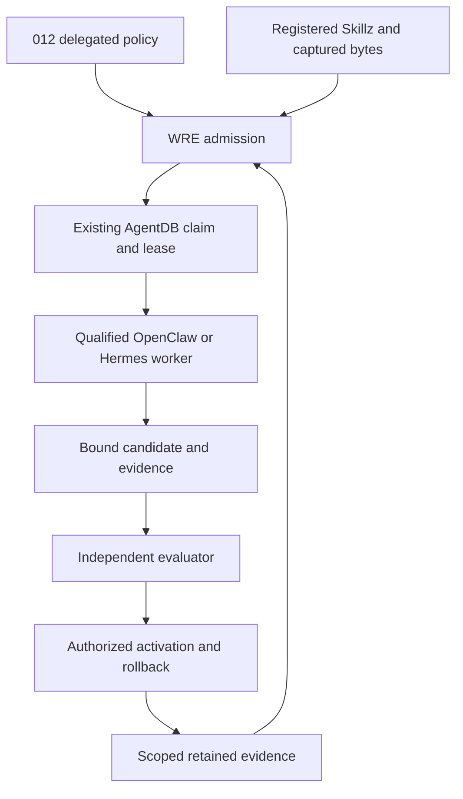

# OpenClaw/WRE swarm proposal: current-source reconciliation

Date: 2026-10-22 JST. Source: `7d33648676712ecfdca9395288a8c2bc5c87a197`.
Status: **AUDITED_DESIGN / NOT_RUNTIME_AUTHORITY**. Scope: the proposal pasted by
012, existing owners, and a corrected implementation specification.

## Decision

Keep WRE as the governed control plane under 012's delegated authority. Use
OpenClaw/Hermes as qualified execution adapters. **Do not scaffold a second
`modules/infrastructure/openclaw_orchestrator/` scheduler, ticket database or
promotion engine from this proposal.** Extend existing owners only where a
bounded integration test demonstrates a missing seam.

The existing [hybrid ticket/team model](../../architecture/REDDOG_HYBRID_TICKET_SWARM_FEEDBACK_MODEL.md),
[system roadmap](../../../ROADMAP.md) and [RSI dispatch record](../../operations/RSI_SWARM_DISPATCH.md)
already establish this direction. A swarm is optional execution topology;
one qualified worker remains the initial/default experiment.

The named `OPENCLAW_WRE_SWARM_ORCHESTRATION_PROPOSAL.md` was not found in this
Git tree or by exact Library title search. Broader retrieval returned older
unrelated pasted-text artifacts, not a verified copy. This audit does not claim
to have read or modified an unavailable full proposal. The cited AGI overview is
available in [PR1835](https://github.com/FOUNDUPS/Foundups-Agent/pull/1835), at
`8262573bf2cbaa6ebc3293bdd207cffee683694f`; it is absent from the audited main.
Its own header calls it a public overview and disclaims runtime authority and
completed production AGI. Its thesis must not replace current executable policy.

## Corrections to the pasted proposal

| Claim | Current evidence and required correction |
|---|---|
| WRE lives at `modules/wre_core/` and `modules/infrastructure/agents/` | The inspected owner is `modules/infrastructure/wre_core/`; the two cited directories are absent. WSP54 role descriptions do not prove deployed instances of those historical agents. |
| WRE is sovereign | WRE enforces admitted policy under 012 sovereignty. Neither the controller nor a worker can mint broader permission from its own output. |
| Atomic POSIX spooling eliminates locking hazards | Atomic replacement concerns one filesystem operation. It does not establish a transactional claim, effect/result commit, no-clobber insertion, crash durability or distributed fencing. Existing code combines replacement with revision checks and locks. |
| Independent machines/volumes can share the proposed POSIX spool | The topology is underspecified. An authoritative queue service may expose bounded job/artifact interfaces; workers must not share writable auth/session stores. A spool, if later needed, is an adapter beneath that owner. |
| Compiled `AGENTS.md` enforces procedure | Generated instructions remain untrusted instruction artifacts. Tool grants, exact source admission, sandbox/effect ceilings and current revocation checks enforce behavior. Root AGENTS is already generated from CLAUDE by `scripts/generate_codex_tooling_projection.py`. |
| Session completion promotes heuristics into WSP60 State1 | WSP60 State0 is archival, State1 is protocol/specification scaffolding, State2 is active operations; module memory is separately owned. Session completion grants no framework write or learning admission. |
| WSP17 is an rESP self-check anchor | Current WSP17 is Pattern Registry Protocol. WSP47 tracks module violations; WSP64 governs violation prevention. WSP21 is Enhanced Prompt Engineering with a Prometheus annex. Use the current master index, not historical labels. |
| WSP15 fourth score is Vision Alignment | Canonical dimensions are Complexity, Importance, Deferability and Impact, each1–5. Work classification and permission are separate decisions. |
| pytest-enforced90% coverage and zero FMAS violations precede a merge receipt | This is an acceptance requirement, not evidence already obtained. WSP5 requires measured module coverage; pytest pass counts alone do not measure it. Bind pytest-cov denominator/report and the exact FMAS scope/command. All required cases must pass. Coverage and structural compliance do not supply independent correctness or merge authority. |
| Semantic progression000→222 proves readiness | These labels can organize planning. Readiness requires explicit acceptance evidence, ownership, runtime qualification, independent verification and permitted activation. |

Protocol sources: [WSP master index](../../../WSP_framework/src/WSP_MASTER_INDEX.md),
[WSP15](../../../WSP_framework/src/WSP_15_Module_Prioritization_Scoring_System.md),
[WSP5](../../../WSP_framework/src/WSP_5_Test_Coverage_Enforcement_Protocol.md),
[WSP60](../../../WSP_framework/src/WSP_60_Module_Memory_Architecture.md),
[WSP95v2.1](../../../WSP_framework/src/WSP_95_WRE_SKILLz_Wardrobe_Protocol.md).

## Reuse map

All paths are relative to repository root. These are source findings, not a
claim that the complete production chain is installed or admitted.

| Responsibility | Existing owner |
|---|---|
| Skill discovery and loading | `modules/infrastructure/wre_core/skillz/wre_skills_loader.py`; adjacent `skills_registry_v2.json` |
| Manifest/scanner admission and captured executor | `modules/infrastructure/wre_core/src/skill_runtime_admission.py`; `registered_skill_executor.py` |
| Ordered authority/work/verification/publication stages | `modules/communication/moltbot_bridge/src/reddog_resident_queue_orchestration_plan.py`; `reddog_resident_queue_stage_handler_registry.py` |
| Durable job publication and claiming | `modules/communication/moltbot_bridge/src/reddog_signed_worker_dispatch_agentdb_writer.py`; `reddog_signed_worker_execution_claim.py` |
| Transaction-bound lease fence | `modules/infrastructure/database/src/signed_worker_execution_lease_fence.py` |
| Uncertain execution recovery | `modules/communication/moltbot_bridge/src/reddog_signed_worker_execution_recovery.py` |
| Read-only monitoring/audit workers | `modules/communication/moltbot_bridge/src/reddog_openclaw_readonly_audit_swarm_runtime.py`; `reddog_openclaw_readonly_audit_swarm_enqueue.py`; `reddog_readonly_0102_audit_worker_runtime.py` |
| Bounded patch materialization | `modules/communication/moltbot_bridge/src/reddog_bounded_worktree_worker_execution_pilot.py` |
| Existing constrained OpenClaw session checks | `modules/communication/moltbot_bridge/src/reddog_openclaw_gateway_confinement.py` |
| Result storage | `modules/communication/moltbot_bridge/src/reddog_resident_queue_chain_results_store.py` |
| Feedback identity and proposal storage | `modules/infrastructure/wre_core/src/skill_execution_truth.py`; `pattern_memory.py`; `wre_master_orchestrator/src/wre_master_orchestrator.py` beneath the same module |
| Independently admitted memory staging | `modules/communication/moltbot_bridge/src/reddog_verified_pattern_memory_sink.py` |
| Compact prompt projection | `prompt/swarm/m2m_compiler.py`; this is not a Skillz production-admission compiler |

Do not rename or relocate these owners merely to match the proposed package.
Directory layout and an instruction compiler cannot resolve missing authority.

## Corrected execution and skill contract

Reuse the existing work-order/envelope fields. Before execution, the admitted
contract must bind the parent/task/attempt identity, principal and FoundUp scope,
exact source snapshot, Skillz/executor digests, runtime/model/tools, allowed
paths/effects, budget/deadline, claim/lease generation, evaluator identity and
acceptance policy. A content digest proves byte identity; signatures, current
authority and independently checked receipts establish different properties.
Do not introduce a competing `task.json` schema just to carry equivalent data.

For the proposed Monitor/Validator/Patcher roles, use existing registered
Skillz/executors and bounded work-order roles. A role name never grants tools.
Monitor emits observations; Validator reproduces the failure in a separately
controlled environment; Patcher writes only its admitted worktree. Reserve an
independent final evaluator outside the authoring team, then the authorized
release owner. Freeze baseline, test oracle and acceptance criteria before the
patcher runs. A new failing test authored by the patcher alone is insufficient.

If per-pod instruction rendering becomes necessary, use a deterministic projection
of already-admitted inputs, record its content digest, and verify those bindings
at consumption. Keep the canonical registered Skillz separate from rendered
context. Do not dynamically rewrite root AGENTS, add production registry entries
or treat generated text as signed policy. First demonstrate that the existing
loader/executor and M2M projection cannot supply the required bounded context.

## Storage, isolation and cancellation requirements

OpenClaw's current documentation supports multiple agents on one Gateway with
separate state/workspace/session scopes. It forbids reusing `agentDir`; it does
not impose a universal one-machine-per-agent rule. Workspace paths are not hard
sandboxes, and plugin storage also requires explicit scoping. Qualify the exact
installed version/configuration; this audit did not inspect a live installation.

Keep credentials/session state private to the admitted runtime and expose only
bounded artifact exchange. A Git worktree isolates changes, not hostile code.
Specify OS/container confinement, filesystem and network allowlists, resource
limits, process-tree cleanup, per-tenant access and private-log retention.

Python documents that `os.replace` can overwrite an existing destination and may
fail across filesystems. Therefore a content-addressed filename plus replace
does not itself enforce immutability. Preserve the existing owner/CAS/lease
protocol; any future local spool must additionally define no-clobber publication,
payload bounds, link/path rejection, file and directory durability, quarantine,
duplicate delivery and platform/filesystem qualification. Do not claim exactly-once
external effects: use bounded attempts, idempotency and reconciliation of unknown
effects under the existing recovery owner.

Concrete lifecycle gap: `_claim_and_execute()` in
`reddog_signed_worker_run_task_runtime.py` observes heartbeat health after its
synchronous runner returns. The heartbeat/lease fence protects finalization;
that code alone does not terminate an in-flight worker on renewal failure.
Before admitting effect-capable pods, prove cancellation delivery, process-tree
termination and effect-boundary fencing. A late successful return cannot erase
an uncertain effect or authorize a retry.

Upstream Swarm currently supplies one-shot local-Gateway collector children,
not a persistent distributed worker scheduler or cloud-placement API. Treat its
fan-out/results interface as a candidate adapter beneath WRE and measure whether
it improves accepted outcomes per total cost before scaling it.

Primary sources checked2026-10-22:
- https://docs.openclaw.ai/concepts/multi-agent/index.html
- https://docs.openclaw.ai/tools/swarm
- https://docs.python.org/3/library/os.html#os.replace

## Feedback and memory: the remaining integration work

PR2175 binds outcomes to loaded instruction digests and stores exact proposal
parents. It does not authenticate outcome quality. Evolution still calls
`recall_failure_patterns`/`recall_successful_patterns` by skill name; their SQL
can mix distinct source versions. The smallest independent feedback repair is
an optional exact-parent selector in those existing methods, passed by
`evolve_skill`, with filtering before limits and compatibility for unscoped calls.

Acceptance for that separate implementation: real SQLite data with two parents
under one skill; matching-only reflection; foreign-version rows cannot exhaust
the limit; malformed/legacy bindings excluded only from scoped mode; existing
callers, unknown quality and promotion blocks preserved. This is a content-lineage
improvement, not model/tool/tenant qualification or proven learning.

The [0102 Moshpit contract](../../0102_moshpit/README.md) remains
`SPECIFIED_NOT_IMPLEMENTED` for ingestion. Its public lessons are sanitized
nominations, not private operational receipts. Reuse its private log owner and
existing WRE/PatternMemory staging boundary. The production sink is explicitly
not activation-ready; WSP95 requires an independent signed promotion chain,
held-out evidence, exact runtime binding and tested rollback. Session end,
high structural fidelity or a majority vote cannot supply those gates.

ROC AutoResearch evaluates its bounded allocation/sustainability contract; it is
not a generic evaluator for arbitrary Skillz. Keep the first skill oracle fixed
and separate. Do not train on raw conversations or let a candidate edit its own
scoring rule. Later use on unseen work, rejected variants, cost and rollback
evidence are required before claiming retained RSI benefit.

## Phased implementation and acceptance

| Stage | Extend existing owners | Required exit evidence |
|---|---|---|
| 0: reconcile | This audit and existing architecture navigation | Correct owners, source/version labels, no new runtime authority |
| 1: one read-only worker | Existing audit assignment, AgentDB claim, supervisor and isolated runner | One valid assignment; duplicate/replay, revoked/expired authority, wrong tenant/source, crash/restart, lease loss, cancellation and bounded artifact cases; no external effects |
| 2: one author plus independent evaluator | Existing bounded worktree/verification/publication chain, after native authority prerequisites | Reproduction fails at baseline and passes at candidate; held-out tests and required coverage/FMAS evidence; path escape/test tampering rejection; exact artifact review; no self-approval |
| 3: feedback candidate | Existing digest-bound outcomes and non-production variation store; scoped recall can proceed independently | Correct parent cohort, rejected candidates preserved, independently controlled oracle; no automatic promotion |
| 4: retained improvement | Existing authorized activation/rollback and R15 canary | Later unseen invocation/control comparison; measured quality/cost; forced regression and successful rollback |
| 5: bounded team | Qualify an explicit flat team profile only after one-worker proof | Compare1 versus2–3 workers; aggregate budgets, reviewer capacity, backpressure, cancellation, recovery and tenant isolation; no assumed distributed scale |

These are proposed acceptance gates, not executed stages or work authorization.
The root roadmap's installed HIGH/authentic author, reviewer/model/budget and
protected-custody prerequisites remain open. This packet does not reassign
another instance's active lane or authorize immediate native execution.

## WSP97 evidence and limits

- Micro pass: inspected actual queue revision/locking, lease finalization,
  synchronous heartbeat handling, Skillz admission, versioned feedback and recall.
- Macro pass: reconciled root roadmap/R15/R18/R25, current WSP index, module
  contracts, Moshpit, existing hybrid model, generated tooling and upstream limits.
- Competing designs: new generic orchestrator/spool versus adapters to existing
  owners. Choose reuse: durable authority, recovery and promotion already have
  owners; a second implementation would divide those responsibilities.
- WSP00 canonical V2 attempt failed because Torch is absent; documented
  section3.3.1 fallback/check passed. Detector witness **ABSENT**.
- Source-bound lexical Holo bundle: exact audited SHA, no overlay, freshness
  **UNKNOWN**, index gap true. Required module docs present; optional artifacts
  missing. Broad hits were noisy and historical audits stale; exact source,
  protocol and current checkpoint reads resolved the ownership questions.
- Independent source audits covered lifecycle/queue and Skillz/memory separately.
  No Qwen/Gemma runtime invocation or native authority was claimed.
- Existing component suites for chain-results storage, read-only swarm enqueue
  and read-only swarm runtime: **46 passed**, two existing pytest configuration
  warnings. Fixtures do not prove deployed pods,90% coverage, full FMAS compliance,
  production authority or a working end-to-end RSI loop.
- No scaffold, runtime code, registry, deployment, IAM, public effect or PR-backlog
  mutation is part of this design slice.
