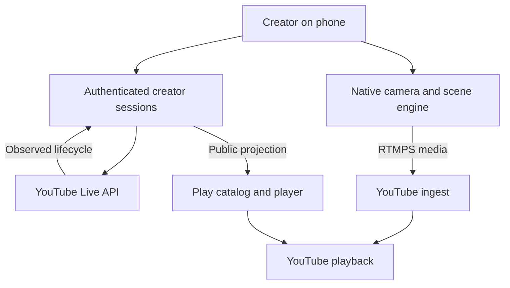

# PFMall Mobile Studio Contract

**Status:** SPECIFIED_NOT_IMPLEMENTED. **Checked:** 2026-10-17.
**Planning owner:** `modules/foundups/pfmall`. **Consumer:** the next admitted
0102 implementation slice. **Source baseline:** Foundups-Agent main
`407292aa754a88143796163581b67ca6679eac29`.

## 1. Pain, outcome and decision

Creators need to start a YouTube show from a phone, switch a few scenes, recover
from a connection drop and have the correct live show discoverable in Play.
Today those jobs span a mobile encoder, YouTube Studio, stream-key handling and
Mall catalog updates. Play already has discovery and playback; it does not yet
join creator authorization, mobile production and provider-confirmed live state.

The proposed outcome is: **one authorized creator selects the correct channel,
previews a mobile scene, explicitly goes live, appears in Play, survives a tested
network interruption, explicitly ends, and starts a later show using the same
valid ingest configuration without duplicating the broadcast.**

Build a native mobile media client plus a scoped creator-session backend and a
public Mall projection. Reuse existing Foundups code through audited adapters.
Keep the phone's media path independent of an LLM response or Mall browser tab.
Begin with direct RTMPS to YouTube; defer relay infrastructure until measured
reliability, remote production or fan-out requirements justify it.

This is a planning contract and research PR. It authorizes no provider calls,
account linking, broadcast, deployment or autonomous work execution. The
[machine-readable outcome](mobile_studio_outcome.v1.json) is not an executable
work order, manifest, accepted allocation or runtime registration. Implementation
requires the existing [build-plan admission contract](../FOUNDUP_BUILD_PLAN_CONTRACT.md)
and an exact, separately admitted slice. No new FoundUp identity is created here.

## 2. Source-backed reuse map

These findings describe code at the baseline, not deployed or device-tested
behavior. Open PRs are not part of this baseline.

| Existing owner | Reuse | Gap or constraint |
|---|---|---|
| [p.fMALL shell](../../pfmall/README.md) | Manifest discovery, routes, catalog projection and advisory state overlays | Read surfaces do not authorize creator writes; development FastAPI is unauthenticated |
| [Member runtime](../../../../public/member/INTERFACE.md) | Video tiles, creator/category filtering, queue player and bounded presentation commands | Opening the player does not prove playback or a publicly live broadcast |
| [Broadcast manager](../../../platform_integration/antifafm_broadcaster/src/youtube_broadcast_manager.py) | Broadcast creation, input reuse, binding and transitions | Channel/token defaults and fallbacks are AntifaFM-specific; audit before extracting a general adapter |
| [Ingest resolver](../../../platform_integration/antifafm_broadcaster/src/youtube_ingest_resolver.py) | Fetch the selected broadcast's bound ingest configuration | Uses heuristic broadcast selection, warning-only key mismatch and RTMP fallback; replace these with exact session/channel/binding checks and required RTMPS |
| [FFmpeg streamer](../../../platform_integration/antifafm_broadcaster/src/ffmpeg_streamer.py) | Server/desktop production patterns | Not an Android/iOS capture and audio engine |
| [YouTube channel pull](../../../communication/youtube_channel_pull/README.md) and [Mall discovery](../../../ai_intelligence/pfmall_discovery/README.md) | Known-channel ingestion and reviewable discovery proposals | Neither proves creator ownership or permission to publish |
| [Member control dispatcher](../../../../public/member/js/pfmall-control-dispatcher.js) | Allowlisted UI presentation actions | No OAuth, resident identity, broadcast or worker authority |

The reviewed catalog is a creator-labelled presentation collection, not evidence
of an operating multi-creator publishing network. Creator payouts, a general live
session service, mobile capture and native scene/audio composition remain absent
from this reviewed slice. Existing channel automation is useful evidence, but its
hard-coded audience/channel choices and key logging must not become defaults in
the new adapter. Preserve creator-selected audience and privacy explicitly.

### Native and open-source candidates

OBS publishes desktop code for Windows/macOS/Linux; a mobile product needs mobile
capture, audio, graphics, permissions and lifecycle work, not only a smaller UI.
Source is already available, so reverse engineering OBS is unnecessary.
[OBS source and license](https://github.com/obsproject/obs-studio).

Evaluate [Moblin](https://github.com/eerimoq/moblin) as the iOS product spike;
[RootEncoder](https://github.com/pedroSG94/RootEncoder) is an Android media-engine
candidate, and [HaishinKit.swift](https://github.com/HaishinKit/HaishinKit.swift)
is an iOS engine alternative. They are different levels of reuse, not equivalent
finished products. Moblin declares MIT, RootEncoder Apache-2.0 and HaishinKit BSD-3;
pin an exact revision and inspect the complete dependency/asset license inventory
before adoption. OBS is GPL-licensed; importing it requires a separate licensing
decision. This contract selects no dependency or distribution license.

General reverse-engineering research can inform interoperability and testing.
It does not establish that another project's code/assets are reusable or that a
Photoshop/game reimplementation solves the phone's media pipeline. Prefer source
and documented interfaces; record provenance and rights for anything imported.

## 3. Proposed ownership and data flow

| Plane | Required responsibility |
|---|---|
| Native phone | Capture, portrait/landscape scenes, mic/media mixing, hardware encode, local recording, transport recovery and visible stop control |
| Creator backend | Authenticate principal and actual YouTube channel; hold delegated tokens; serialize mutations; persist IDs, intent and observed state; enforce quota and revoke access |
| YouTube | Authoritative provider event, ingest health, visibility and playback availability |
| Play browser | Discover and display permitted metadata; embed where permitted, otherwise offer a watch link; issue untrusted intents only |
| Future 0102 adapter | Translate admitted creator intent through existing RedDog/OpenClaw/WRE boundaries; it cannot grant itself channel or publication authority |

A relay is optional later. SRT or WebRTC may feed that relay, but YouTube's direct
path here is RTMPS. A transport relay alone provides neither scene mixing nor
guest audio mix-minus. Browser widgets may render visuals in a native scene;
their digital audio route, especially with headphones/external microphones,
requires device evidence. Playing alerts through a speaker into the mic is not
proof of a proper audio mix.

## 4. Proposed machine contract

The following are logical adapter operations, **not implemented endpoints**:

| Operation | Required precondition | Durable result |
|---|---|---|
| `PrepareSession` | Verified principal/channel mapping; explicit title, schedule, privacy, audience, monitoring and start mode | Server-issued session ID/revision; creator consent reference; normalized request digest; planned channel |
| `CreateBroadcast` | Session scope, quota budget, reconciled prior attempt | Broadcast ID and observed lifecycle, or explicit uncertainty |
| `ResolveInput` | Correct channel; compatible ingest format; reusable-input policy | Input ID and credential reference; never a key in a public result |
| `BindInput` | Explicit broadcast and input IDs; ownership and state verified | Provider-confirmed binding |
| `StartLive` | Explicit creator intent; bound input active; chosen monitoring path satisfied | Start requested; live only after provider observation |
| `InspectSession` | Read authorization and budget | Separate encoder, ingest and broadcast observations with timestamps |
| `EndLive` | Authorized end intent; current state reconciled | Complete only when observed; preserve archive-pending separately |

Each mutation must carry `request_id`, `principal_id`, `youtube_channel_id`,
`intent_digest`, `consent_ref` and an expiry. `PrepareSession` uses these common
fields and returns a server-issued `session_id` and initial revision; subsequent
session mutations also require that ID and `expected_revision`. A repeated
prepare request returns the same accepted session when its authenticated scope
and digest match. The backend independently resolves identity and credentials;
those fields are claims until checked. A credential reference is not a bearer grant.
Reject a changed payload under the same request ID and concurrent controllers
with stale revisions. Persist mutation intent before the external request and
results afterwards. Do not imply that YouTube supplies an idempotency-key API.

An insertion can succeed while its response is lost. Reconcile durable IDs and
provider observations before retrying. If an ambiguous creation cannot be
identified safely, return `uncertain` for operator resolution; do not blindly
create again or delete a possibly valid show. Track any orphaned provider object
for explicit cleanup. Two independent encoders must not concurrently publish to
the same input in the initial product.

Observations must distinguish:

- `transport_state`: phone/relay connectivity and local encoding evidence.
- `ingest_state`: provider stream activity and health.
- `broadcast_state`: provider lifecycle, including transitional states.
- `playback_state`: embed capability and actual player result, if observed.
- `observed_at`, `source` and `revision`: freshness and evidence provenance.

The local session may report preparing, ingesting, starting, live, reconnecting,
ending, complete, blocked, failed or uncertain. These are local workflow states,
not replacements for YouTube enums. Terminal provider states cannot be revived.
Stale/unavailable evidence yields unknown; it never upgrades to live. Persist
secrets separately and redact them from receipts, telemetry and error strings.

## 5. Provider limits that shape the build

The [API constraints register](PFMALL_CREATOR_LIVE_API_CONSTRAINTS.md) owns dated
quota values, eligibility, OAuth, lifecycle, retention and playback-policy facts.
Revalidate it at implementation and release; actual project/channel status is
UNVERIFIED. In particular:

- A later show reuses a valid input, but gets a new broadcast/event identity.
- Live eligibility and live-embedding eligibility are separate gates.
- Choose monitoring/auto-start/auto-stop before publishing. The first controlled
  mobile flow proposes manual start and explicit end with auto-stop disabled;
  no outage duration is guaranteed by that choice.
- Reserve write quota for start/end/recovery. Multiplex chat observations and
  respect the provider's polling interval; many browser viewers must not each
  run an independent API polling loop.
- Mall membership and a catalog creator label do not establish YouTube OAuth
  authority. A Studio delegate may also lack API access.

Publish only creator-approved, public-safe fields: creator identity, broadcast
ID, title, watch URL, optional approved embed URL, lifecycle evidence, freshness
and archive state. A private/unlisted event is excluded from public discovery
unless an explicit policy appropriate to that visibility admits the projection.
No OAuth token, ingest secret, private channel/account detail or raw API payload
belongs in static catalog JSON, browser commands or Holo ingestion.

Keep Play's ordinary membership/account experience distinct from paid access to
YouTube playback. Any proposed paid benefit needs an independent deliverable and
policy review; YouTube membership status, payment settlement and creator payouts
are separate systems. No entitlement, payout or revenue-sharing ledger is built
or assumed here. Preserve YouTube attribution and player controls; place studio
graphics in the creator's composed output, not over embedded player controls.

## 6. Ordered build slices and measurable gates

These are proposed slices, not authorized worker assignments or delivery dates.
One implementation PR should take one bounded slice and update this contract,
the [owner roadmap](../../pfmall/ROADMAP.md), interfaces and ModLog before promotion.

| Slice | Intended delivery | Exit evidence | Current blocker |
|---|---|---|---|
| MS0: evidence and plan | Current reuse map, API register and machine outcome | Linked, parseable, reviewed docs | Completed by this documentation slice only |
| MS1: account and API spike | One explicitly authorized test channel; scoped adapter and deterministic provider fakes | AC01–AC04; quota/consent receipts; controlled real-channel round trip when separately authorized | OAuth project/client/channel selection and actual capability checks |
| MS2: mobile media spike | One device/platform; camera, mic, preview, direct RTMPS and local recording | AC05–AC06; device/build identifiers and recordings | Platform/device selection; native media engineering; permission and thermal evidence |
| MS3: Play live projection | Provider-confirmed discovery, permitted embed or watch fallback | AC07–AC08; stale-state and visibility cases | Secure creator service and authoritative read projection |
| MS4: production reliability | Reconnect/runbook, quotas, OAuth release verification, data deletion and support | AC04, AC06, AC09; real-device soak and revoke evidence | Multi-creator isolation, provider approval, operational ownership |
| MS5: optional expansion | Second OS, richer scenes, relay/multistream, guests and independent paid services | A separate contract and measured demand for each feature | No assumptions that a relay, API or membership solves these features |

### Acceptance identifiers

| ID | Testable result required for implementation promotion |
|---|---|
| AC01 | Wrong creator/channel, expired consent and browser-supplied identity fail closed before any provider write; selected privacy/audience survive round trip |
| AC02 | A controlled event creates, binds, starts and ends on the selected channel; source observations distinguish requested versus completed transitions |
| AC03 | A second event has a different broadcast ID and can reuse the original valid input ID; no duplicate binding or event after duplicate commands |
| AC04 | Lost create response, process restart, stale controller and repeated end are reconciled; ambiguous creation stays uncertain without a new duplicate |
| AC05 | Proposed initial target: portrait 720p30, mic plus one graphic and local recording for 30 minutes; measure encode drops, A/V sync, heat, battery and recording integrity; set device-specific release thresholds before promotion |
| AC06 | Wi-Fi/cellular handover and controlled 10/30/90-second interruptions produce truthful status and bounded retries; separately test lock/background, calls, denied permissions and headphones/external-mic alert mixing; no support claim for an unpassed case |
| AC07 | The correct creator's show appears only from fresh permitted provider evidence; terminal/stale/private cases never appear as an asserted public live show |
| AC08 | Embed-denied and player-failure cases offer a working approved YouTube watch link; UI-open events are not accepted as playback proof |
| AC09 | Project/creator quota limits, 403 categories, token revoke and deletion requests are exercised; secrets never appear in catalog, logs or evidence artifacts |

For AC05, the proposed target is a spike workload, not a validated hardware claim.
For AC06, report measured recovery time and final provider state for each trial;
do not promise that every network outage can preserve a broadcast. Record actual
device, OS, native build, dependency revision, provider IDs and observation times
in access-controlled evidence; publish only redacted references to the repository.

## 7. Handoff, verification and closure

Consume in this order: owner README/INTERFACE/ROADMAP, this contract, the API
register, then `mobile_studio_outcome.v1.json`. The adjacent `doc_index.json`
provides hashes and attachment paths. It covers this bounded subcollection; it
does not claim a semantic Holo generation was rebuilt or a runtime was admitted.

The [WSP 97 receipt](wsp97_execution_receipt.json) records this documentation
execution, including the documented WSP 00 fallback and lexical Holo evidence.
Receipt validation establishes structural/repository evidence only. The next
implementation must reread current main, inspect active related PRs, revalidate
external facts and produce new exact-slice verification. Docs-only validation
must not be presented as successful streaming, device tests or deployed behavior.
