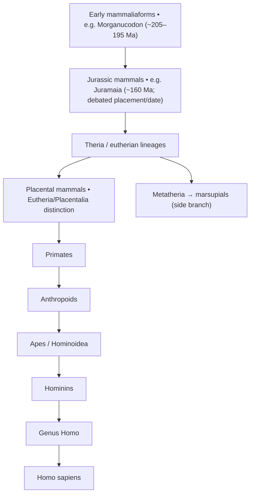

# EDUIT → Storytime → Evolution: vision and progression contract
Date: 2026-10-28. Status: proposed product specification, not shipped.

## FoundUp: three mandatory questions
**Pain:** Children need engaging, accessible, repeatable learning that is not a fixed one-time lesson; families lack continuity and feedback across educational games. Human-only authoring limits content variety and iteration.
**Solution:** EDUIT's educational FoundUp delivers modular WATCH → PLAY → VERIFY tiles. Reviewed learning objects (words, numbers, sounds, languages) can be substituted independently of the game mechanics. Governed RSI workers improve tiles using developer/editor feedback and independent tests, not unconsented child telemetry.
**Outcome:** An accessible, self-improving educational game ecosystem in which learners can join, learn, replay varied lessons, and optionally retain their progress. The Educational Singularity is the historical framing; autonomous generation and measurable learning impact remain goals, not verified deployments.

EDUIT is the FoundUp. Storytime is an experience/catalog within EDUIT. Evolution is a Storytime narrative learning path. Episodes/tiles are content, not FoundUps. Each tile has **WATCH (video demonstrating story/how to play), PLAY (interactive practice), VERIFY (formative test of that round's actual learning objects)**.

## Evolution roadmap pop-up: scientific taxa and fictional characters
The map must use recognized fossil taxa or clades, approximate ages and evidence confidence; each game's friendly character nickname is a separate presentation field. **Early mammals were not simply marsupials**: the marsupial/placental divergence is a later branching history. Avoid claiming a particular fossil species was a direct human ancestor.

Provisional educational progression (not a literal unbroken chain of named direct ancestors):

This is a **clade-based learning map**, not evidence that Morganucodon or Juramaia were direct ancestors of humans. Fossil dates and taxonomic assignments need paleontology review before publishing. The current ~150 Ma Little Shrew episode is a **fictional Jurassic mammal-like character**; mark **YOU ARE HERE** on that episode at the Jurassic-mammal stage, not on a falsely identified fossil species. If the story introduces three shrew-like character types, give them distinct nicknames and learning roles; do not represent them as three scientific evolutionary branches without fossil evidence.

Suggested data fields per node: `taxon_scientific_name`, `taxon_rank`, `approximate_age_range_ma`, `source_citations`, `evidence_status`, `fictional_character_nickname`, `episode_id`, `release_status`, `parent_node_ids`, `you_are_here`. Only released episodes navigate; future nodes show Planned. Human evolution is one branch of the mammal tree, not evolution's predetermined endpoint.

## Modular lesson object examples
- **Sound/word:** THUMP, SNIFF, CRUNCH, SQUISH; three reviewed objects per play, age-appropriate, non-graphic.
- **Counting:** visible shrew #1 → display numeral **1** and locale-specific written number **one** while saying it; highlight **1**, then fade; repeat 2/two, 3/three, 4/four, 5/five, synchronized to actual five characters. Japanese and other languages use reviewed numeral words and recorded/approved speech; digits 1–5 may remain Arabic numerals.
- **Vocabulary:** word → visible action/object → matching verification; switch packs only where the scene actually supports the cue.
- **Replay:** completed tile → VERIFY → score/feedback → Replay. Slightly increase speed within accessible reviewed limits (never force a speed increase); rotate to another compatible approved lesson pack. If no alternative reviewed pack is available, allow repeat honestly.
- **Assessment:** VERIFY always tests only the selected round's three objects; do not ask number questions unless counting appeared in PLAY.

## Existing UI: About / How / Roadmap
- **About** should link to EDUIT's historical Education Using Information Technology vision and the FoundUps project; clarify Storytime is one EDUIT experience. Explain the fictional Little Shrew as the beginning of a journey exploring mammal evolution and human origins, without claiming direct shrew ancestry.
- **How** should teach WATCH → PLAY → VERIFY, wake the five characters, guide them to the green vine, recognize cues, match three objects, then choose replay or next. Include practice, sound, accessibility and gentle replay acceleration.
- **Roadmap** is a separate, accessible mind-map modal with current node, three opening branches, simplified later evolution milestones and visible release status. No dead links, forced unlocks or fabricated episodes.
- Preserve existing pop-up/modal owner and shared Mall architecture; inspect live source before changing UI. Documentation alone does not establish that modal changes shipped.

## Player memory and sign-in
- **P0:** Anonymous, optional, device-local learning history, controlled and clearable by parent; no child identity, birthday, analytics, cross-child comparisons, advertising or RSI training data.
- **P1:** Parent-managed sign-in using existing FoundUps authentication/tenant ownership *after* authorization and privacy review. Keep child profile pseudonymous and parent-controlled; scoped progress only, explicit consent for sync, delete/export controls, no child-facing OAuth prompt. No new auth service.
- Track `tile_id`, `tile_revision`, `lesson_pack_id`, `locale`, completed components, assessment outcomes and speed setting minimally. Do not conflate game score and learning verification or infer intelligence.
- Offline/guest remains usable. Parent login is optional, not a gate to learning.

## WSP97 implementation and acceptance
Audit actual source and existing skill owners before implementing; reconcile README/INTERFACE/ROADMAP, TILE_PRODUCTION_RSI, STORYTIME_RSI_SYSTEM_ARCHITECTURE and Kids Episodes schemas. Extend the canonical three-part tile contract rather than creating a competing schema. Prioritize (1) content/assessment wiring and deterministic tests, (2) counting/locale packs, (3) About/How and accessible Roadmap modal, (4) optional local memory, (5) parent sign-in after consent/security review, (6) next different tile transfer. Test complete WATCH→PLAY→VERIFY; matching objects on replay, five counts with numeral + localized word, no mismatched quiz, speed cap and untimed path, modal keyboard/focus, roadmap status, guest/privacy deletion and locale fallback. WRE verification must use independent synthetic fixtures and educational review; no autonomous publishing or live child-data ingestion. PR squash merge and verify exact main SHA before marking done.

## First-visit introduction — implemented on PR branch; browser acceptance pending
The existing Shorts-owned Storytime viewer now presents an illustrated MAMMA introduction in a native modal on the first visit, before the existing video. It describes fictional furry Jurassic mammals ~150 million years ago and shows MAMMA 🥚, MAMMA 🦘 and MAMMA 🤰 as child-friendly mnemonics, not a linear evolutionary sequence. The sticky **Close × button is at bottom-right** for one-thumb access, with Skip on the left. Dismissal animates toward the video and honors reduced-motion preference; video audio does not autoplay. The **Story** control reopens it. The device-local flag \`eduit.storytime.intro-seen.v1\` suppresses subsequent automatic openings; no child identity is collected. Existing About/How remain independent. Verify mobile Safari/Android, keyboard/screen-reader, reduced-motion, focus and gameplay regression before merge. TTS and quiz remain separate unimplemented features.

## EDUIT Learning Engine: staged implementation
**Five hand-reviewed lesson packs first; generated packs later.** Prototype pack rotation must keep the same approved episode cues and distinct concepts: sound-action matching, counting 1–5 with synchronized written and spoken number words, visually identifiable objects, language-specific vocabulary, and sound/action review. Never assert that a pack is playable until its cues and answer images exist. Store per-concept anonymous local success history only with guardian-controlled deletion; cross-device persistence requires a separate parent consent/auth design.

**Spacing and retrieval:** distinguish replay variety from retention. Prefer a blend of a new concept and one previously encountered concept due for review, with adjustable gaps informed by retrieval success; never randomize away needed review. Research supports spaced retrieval but does not prescribe one universal timetable, especially for preschool children: Cepeda et al. (2006), https://pubmed.ncbi.nlm.nih.gov/16719566/ ; Cepeda et al. (2009), https://pubmed.ncbi.nlm.nih.gov/19439395/. The named Japanese company “ratio” remains unverified as the source of this learning science; do not attribute a proprietary algorithm to it without confirmation. Pilot review timing, avoid mastery claims, and require educational review.

**Game design:** after the video, game, and optional post-round verification, replay may increase tempo only in bounded steps with untimed override. A contextual Help control can demonstrate a single wake-and-move action without penalties or automatic score inflation; design and test before enabling. Keep assessment in a post-game modal rather than a permanent third panel. Integrate tile metadata with PF Mall as released/locked state; do not create a second catalog. For the existing About/How dialog, keep a scrollable description and bottom-right close on mobile. The first-visit intro uses the same bottom-right convention.
