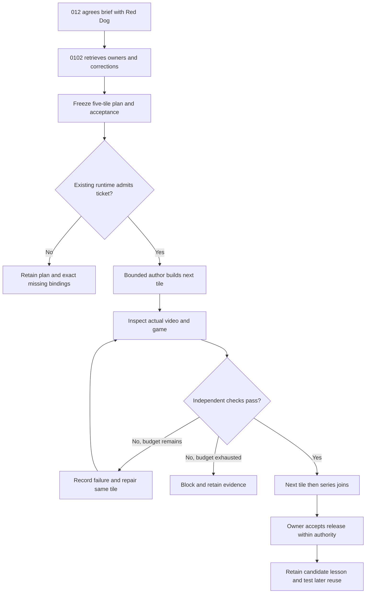

# Storytime: correction-driven, five-tile production contract

2026-10-28 · WSP 97 · owner: EDUIT learning/interaction, Kids Episodes production.

## Status and first layer

**IMPLEMENTED (local planning only):** Kids Episodes
[`tile_batch.py`](../../kids_episodes/src/tile_batch.py) prepares five ordered
video+game work pairs and a series review, with deterministic plan identity,
bounded repair proposals and a fixed review-record completeness check.
**SPECIFIED:** translation into admitted FAM/WRE tickets, worker execution,
authenticated review, promotion and retained use. No runtime worker is activated.
A returned empty failure list proves record completeness, not evidence truth.

One tile means **one matching video + playable activity + learning objective +
cue sheet + revision**, not a new FoundUp. A five-tile production batch is not
necessarily a five-mission player progression set. The latter has its own
[evolution/progression contract](EVOLUTION_PLAY_AND_SHARING_ROADMAP.md).

The next real tile is the forward test. Build it, inspect it, repair it, and
independently review it before propagating the approach through the remaining
four. Do not generate five unreviewed copies of the same defect. Reserve the
reviewer and time/budget first; stop at the declared repair limit.

## Decision tree and authority

012 approval of direction supplies scope; it is not a fabricated signed runtime
credential. Routine audits within delegated scope need no repeated approval.
Changed audience/story canon, budget, effects or unresolved disagreement goes
back to the existing owner. Model agreement cannot override a failed criterion.
Existing authorized interactive development may execute locally without claiming
that the production worker has been admitted.

## Reuse the existing kitchen

| Responsibility | Existing owner and integration limit |
|---|---|
| Conversation and work intent | Red Dog fast surface → deep 0102; preserve original spoken wording and confirmed STT terms. No new voice/backend/account plane. |
| Business tickets and proofs | `modules/foundups/agent_market/src/task_pipeline.py`: Task/Proof/Verification. Reuse the [R24 packet](../../../../docs/roadmaps/R24_AGENT_PRODUCTION_LINE_PACKET.md) and [hybrid ticket model](../../../../docs/architecture/REDDOG_HYBRID_TICKET_SWARM_FEEDBACK_MODEL.md). Integrated line is not yet proved. |
| Claim, lease, cancellation and admission | Existing AgentDB/WRE owners; no separately mutable OpenClaw/Hermes backlog. A lost response requires reconciliation, not a second effect. |
| Coordination / bounded worker | OpenClaw hub; Hermes leaf where qualified. This is the existing WRE allocation, not two new autonomous services. Reserve a verifier outside the author team. |
| Media and game | `kids_episodes/src/story_pipeline.py` owns story/media validation; Shorts owns render/publish; EDUIT shared scene/game owns activity. Do not duplicate these in a batch compiler. |
| Production boundary | `kids_episodes/src/work_order_adapter.py` continues to block absent admitted executor, workspace and authority bindings. Never route story production as Hermes's generic FoundUp repository-build action. |
| Learning and promotion | WRE `pattern_memory.py`, `pattern_ab_evidence.py`, `skill_runtime_admission.py`; no second outcome database or self-promoter. |
| Karpathy-style loop | WRE `wre_auto_researcher.py`: fixed oracle, bounded candidate, evaluate, retain/reject. Existing ROC evaluator is not a Storytime visual/education judge; live researcher commit is not implemented. |
| Model comparisons | AI Gateway `model_champion_challenger_autoresearch.py` and configured runner compare models under their own admission/budgets. A keyword judge cannot certify a child-facing game. |

Before dispatch, bind each proposed tile ID to canonical story-plan/episode IDs,
source span, video digest, game/scene revision, cue sheet, learning goal and
artifact manifest digest. The planning function does not resolve these objects.
The manifest must bind **both** video and game bytes plus locale/scene/cues;
reviewing just the MP4 cannot approve the activity. Live reviewer independence
must be authenticated by existing owners; different strings alone prove nothing.

## Frozen acceptance oracle: eduit.tile_acceptance.v1

A rating is the existing interactive-review ordinal scale, not WSP 15 priority,
a child's grade, or a runtime authorization. Grade each criterion separately:
1 blocked; 2 major defect; 3 usable but gaps; 4 scoped evidence passes with named
platform limits; 5 independently verified on every declared surface. Grades
below 4 or missing observations block local completeness; never average them.
An excluded physical-device claim stays excluded, not silently upgraded to 5.

| Criterion ID | Required observed evidence |
|---|---|
| causality | Full anticipation → action → consequence in the approved scene; inspect intermediate motion, no-input ending and intended safe region. Pilot regression: falling roof, growing cracks, retained pocket. |
| continuity | Lock the approved palette, geometry, character arrangement and scene state; film/game differences explicitly intentional. Pilot regression: earth color, parents above children, no unwanted shelf/marker. |
| sound_word_action | Approved learning words near their visible cause, readable without covering faces/targets; actual listening plus timed word/action inspection. Pilot examples: THUMP/SNIFF/CRACK/SQUISH. Source timestamps alone fail. |
| science_age | One age-appropriate objective, short language, branching evolution rather than ladder, no real gene purchases or inherited learned memory. |
| phone_tablet_controls | Rendered CSS bounds: current minimum 64px primary controls; 320×568, 390×844, 568×320, 768×1024; no overlap/overflow; safe areas and orientation. Physical Home Screen separately observed or explicitly excluded. |
| touch_mouse_keyboard | Actual applicable mouse/keyboard paths and pointer lifecycle; synthetic pointer tests labeled synthetic, never native touch proof. |
| fullscreen_feedback | Each panel expands/collapses; switching works; pencil freezes exact frame; marks retained through resize; snapshot/share/cancel; child lock does not strand adult. |
| pause_resume_reset | Hidden tab, dialog, locale and feedback pause clocks; resume preserves round; reset clears documented state and points once. |
| solvability_scoring | Declared objective achievable through slower deliberate input/practice; score awarded once for the approved completion event, bonus bounded, seeded variation reproducible. Pilot regression: all five rescuable and once-only arrival points. No aptitude inference. |
| privacy_rights | No secrets/child profiles/play traces into RSI; original/licensed assets; server-owned publish/auth/quota; no fake AI status or membership. |
| video_game_pair | Exact matched revision/manifest; video above game; activity shares learning cues; next points only to reviewed available tile. |
| independent_output_review | Reviewer outside author team inspects raw changed output and failures; full-series joins reviewed separately; no author-only pass receipt. |

Freeze applicable surfaces and tests **before** editing. If the contract needs
changing, version it and independently approve the change separately from the
candidate; do not lower a threshold just to make a repair pass. Tests and actual
render/listening review complement each other. No source-string assertion proves
readability or audio comprehension.

## Correction ledger: prior feedback becomes future regression coverage

These are attributed to 012's collaboration and existing receipts, not claimed
as autonomous discoveries. They are candidate transferable rules until verified
on the **next actual tile**, not an invented unrelated story.

| Prior correction | General rule / required next check | Existing evidence anchor |
|---|---|---|
| Brown changed at collapse; chamber line survived | Lock material identity; inspect intermediate and final occlusion | ModLog collapse-4; `tests/storytime.test.mjs` |
| Removing green line moved family into a row | Separate requested removal from approved perspective/layout | `docs/RESCUE_GAME_REVIEW.md`; continuity pass |
| Words absent/small or detached from sound | Audit sound + word + cause together; device-size output inspection | `docs/PRESCHOOL_VIEWER_REVIEW.md`; cue tests |
| Tiny fullscreen buttons and wasted phone space | CSS controls independent of art scaling; inspect short landscape too | `docs/LEARNING_SHELL_REVIEW.md`; `tests/director_harness.html` |
| Cannot freeze and mark while fullscreen | Test exact-state freeze, annotate, export, resume in both panels | `docs/EPISODE_TILE_CONTROLS.md`; viewer harness |
| Game ended too fast because film was 15s | Separate film clock from activity pace; deliberate-input/practice test | `docs/SLOW_RESCUE_AND_AGENT_ROADMAP.md`; engine tests |
| Promised learning did not reach future work | Bind candidate rule to regression and next-tile reuse receipt | This contract; transfer still pending |

For every future correction retain: source reference, affected revision, observed
failure, cause hypothesis, invariant, test/evidence IDs, repair, independent
grade/dissent, accepted/rejected result, rollback revision, next-use result.
A screenshot annotation is feedback input, not authenticated runtime memory.
Only product-development evidence belongs in this ledger; never child play data.
Update existing review receipts and ModLog; do not create a competing database.

## Next implementation tickets (not activated jobs)

1. Reconcile and approve the actual next five story briefs; freeze shared bible,
   learning progression and manifest format. Existing pilot remains three films;
   do not silently expand it to five or change its 15s compiler contract.
2. Connect this planning projection to the existing admitted FAM/WRE owner only
   after authentic runtime bindings exist. Prove refusal, cancellation, lease
   recovery, idempotent output and independent-review lineage on a disposable job.
3. Build the next real composite tile using current renderer/game, run the oracle,
   independently inspect actual media and game, record transfer successes/failures.
4. Continue the remaining four under the same budget; hold later work if an earlier
   reviewed continuity state changes. Re-review affected descendants and joins.
5. Feed admitted outcomes into existing WRE memory; compare fixed baseline and
   candidate, test held-out layouts/seeds, rollback on regression and prove a later
   invocation consumes the retained rule. Only then claim measured RSI reuse.

A batch is not done because eleven ticket records exist. Report planning,
production, independent review, runtime admission, merge, deployment, publishing
and retained learning separately. Current site/game behavior is unchanged.

## This contract's independent review

An independent source reviewer ran the four unittest methods plus malformed
inputs, invalid grades and DAG probes, and resolved all relative document links.
Review found an actual defect: the first oracle draft required roof/cracks and
pilot words in every future story. Repaired to generic approved-scene/cue rules,
with pilot details explicitly labeled regression examples. Re-review found no
blocker; contract, malformed input handling, ownership and portability each4/5.
This demonstrates a bounded correction cycle, not retained autonomous RSI.
Transfer to the next actual tile remains pending. Lesson: separate reusable
invariants from story-specific fixtures before applying a skill to a new tile.

## Mandatory post-merge CI acceptance gate (2026-10-28 correction)

Incident: Storytime victory PR #2244 introduced a deliberate `celebrating` phase but retained a regression expecting immediate `over`. Kids Episodes run 40622731429 failed (17 passed, 1 failed). Test correction PR #2245 was squash-merged; that merge alone is not proof of a green main run.

For **every** EDUIT/Storytime RSI iteration:
1. Before PR: identify impacted behavior and update or add regression tests alongside code; run available local focused tests and independent visual/audio checks where applicable. Do not weaken assertions merely to obtain green status.
2. Open a PR with changed files, test evidence and known limitations. Inspect required PR checks before squash merge. If checks are pending or failing, repair on the PR branch; do not treat a successful GitHub merge API response as acceptance.
3. After squash merge: capture the **new main SHA**, retrieve workflow/check runs **for that exact SHA**, and require relevant jobs to conclude successfully. A status endpoint with no checks is UNKNOWN, not green; a PR-head pass does not establish a main-head pass.
4. If post-merge CI fails: inspect the failing job logs, repair the cause in a new bounded PR, rerun/verify, and keep the task **BLOCKED** until the resulting main SHA has verified green required checks. Preserve failure and correction in ModLog and existing WRE outcome memory when admitted.
5. Report separately: code committed, PR merged, main CI verified, live browser/audio/device verified, deployment verified, and RSI transfer demonstrated. No silent promotion from one state to the next.

The release gate must not depend on user notification. Automated branch protection/required checks should enforce pre-merge CI where repository permissions allow; documentation alone does not configure GitHub protections or establish a continuously running agent.
