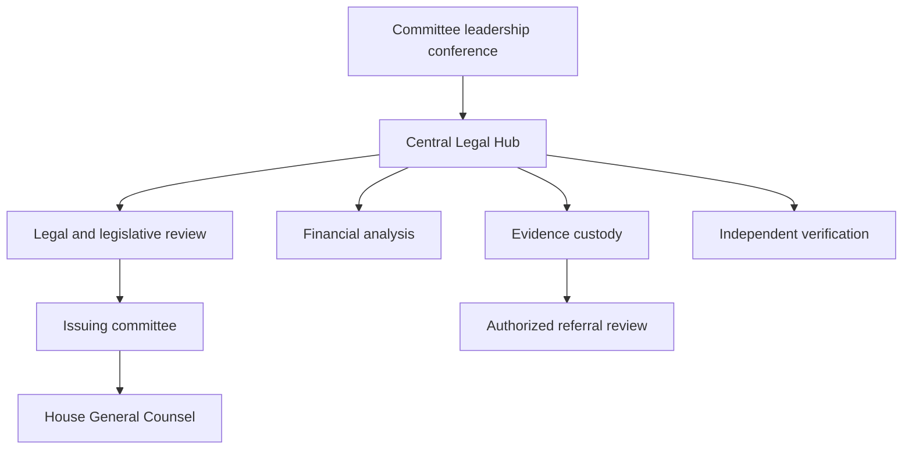

# Section I — The Central Legal Hub and Governing Authorities

**Legal research cutoff: November 5, 2026. Operational design: proposed for the 120th Congress, 2027–2028.** The Hub described here does not presently exist, possess compulsory powers, or represent a government agency. Its public research component may collect lawful public records and develop legislative proposals. Only duly constituted governmental bodies may exercise the governmental authorities discussed below.

## 1. Institutional charter and decision rights

The Central Legal Hub should be a shared professional service of participating House committees. Its mission is to identify gaps in federal financial-integrity law, support properly authorized oversight, preserve reliable evidence, and make lawful referrals. It must not become a congressional prosecutor's office. Congress's legislative inquiry and a prosecutor's determination of criminal liability are distinct functions. A referral communicates information; it neither establishes guilt nor instructs a prosecutor to charge.

Participating committees should adopt a joint investigative charter specifying the subjects, legislative questions, lead committee for each request, participating counsel, access controls, budget, and conflict-resolution procedure. Each compulsory request must trace to a committee with relevant jurisdiction and valid authorization. A Hub task number or staff director's instruction does not substitute for committee authority. House Rule X assigns committee jurisdictions; Rule XI, clause 2(m), governs committee subpoena powers. The proposed resolution in Appendix A adds common procedures while retaining these foundations. [A1, A2]

A chair-and-ranking-member steering conference should meet weekly, supported by a daily operational conference of designated staff. The conference coordinates schedules, identifies duplicate demands, and decides whether a proposed joint deposition genuinely advances more than one committee's inquiry. The originating committee retains custody and release authority over its records unless an adopted rule validly provides otherwise. An unresolved disagreement about legislative jurisdiction goes to the Speaker and Parliamentarian through established House processes, rather than to a forensic analyst.

The Hub should employ a staff director; chief investigative counsel; legislative director; director of forensic accounting; evidence and information-security director; records officer; witness-protection and privacy counsel; state-referral counsel; and an independent verification editor. Majority and minority designees should receive the same material at the same time when entitled to it. Appropriate statutory exclusions still apply. Former prosecutors may bring interviewing and financial-analysis expertise, but congressional counsel act as congressional counsel and must not imply that they control charging, immunity, forfeiture, or a state grand jury.

Every case opening should produce five records: an authorization memorandum, legislative-purpose memorandum, collection plan, access-and-retention plan, and alternative-explanations register. The collection plan should identify the least burdensome sufficient sources, including public filings and voluntary production, before compulsory process. The alternative-explanations register should name facts that would weaken the working hypothesis and assign someone to seek them. A transaction inconsistent with a hypothesis must remain visible in the analytic record.

## 2. The authority baseline: what actually changed in the 118th and 119th Congresses

Staff-led depositions without Member attendance are already part of modern House practice. The improvement proposed here is codification in standing rules and consistent operation, rather than invention of a power first appearing in 2027. H. Res. 5, 118th Congress, section 3(k), and H. Res. 5, 119th Congress, section 3(t), provide deposition authority to standing committees except Rules and to the Permanent Select Committee on Intelligence. Both authorize examinations by a Member or committee counsel after consultation with the ranking minority member. The House Manual records removal of the Member-attendance requirement in the 116th Congress. [A1–A3]

| Subject | 118th Congress baseline | 119th Congress baseline | Proposed 120th improvement |
|---|---|---|---|
| Staff depositions | H. Res. 5 § 3(k); separate order | H. Res. 5 § 3(t); separate order | Put common authority in standing Rule XI; retain specialist limits |
| Attendance | Counsel may conduct; limited attendees | Counsel may conduct; limited attendees | Expressly state that Member presence is unnecessary |
| Joint depositions | Read applicable regulations and committee rules | Deposition regulation 4 expressly permits joint-investigation designation | Common custody, minority notice, and release rules |
| Three-day timing | Consultation and notice requirements in regulations | Regulation 2 specifies three counted days, with an express exigency exception in the all-Member notice sentence | Express, narrow exception covering consultation and notice; document reasons |
| Remote witnesses | H. Res. 5 § 3(j), nongovernmental capacity | H. Res. 5 § 3(i), executive-branch exclusion, plus implementing restrictions | Express secure remote-deposition authority with authentication controls |
| Seven-Member request | § 3(i) requires chair as one signer | § 3(s) carries chair requirement | Decline to renew the additional House restriction |
| OGC litigation | Rule II institutional direction remains relevant | § 3(v) specifically continues identified subpoena litigation | Adopt affirmative prospective House authorization with a completed authorization record |

The 119th deposition regulations matter as much as the enabling resolution. Regulation 2 distinguishes consultation with the ranking member from written notice to all members; its express exigency language appears in the latter sentence. A committee should not assume that any existing exception eliminates both requirements. Regulation 4 already supports joint investigations. Regulations 5–6 allow designated counsel to question in equal-time rounds, ordinarily no more than sixty minutes per side, with up to four questioning counsel per round. Regulations 7–10 cover privilege objections, appeals, transcript correction, certification, simultaneous leadership access, and release disputes. Regulation 11 requires provision of the governing authority and regulations to a witness. Appendix A preserves these protections while defining a narrow emergency process. [A4]

Remote public testimony is not interchangeable with a remote staff deposition. The 119th separate order is accompanied by regulations limiting remote participation, including governmental-capacity restrictions and leadership approval requirements. An officer should not infer a universal power to conduct every compelled examination by video from the existence of ordinary commercial videoconferencing software. The proposed rule makes the deposition route explicit, requires an authorized oath administrator and approved platform, and leaves constitutional and statutory objections intact. [A1, A5]

## 3. The Unified Forensic Evidence Vault must be federated by legal authority

A common catalog is useful; a common unrestricted data pool is legally unsound. The Vault should therefore be a federation of separately governed compartments. Document text, OCR, embeddings, link-analysis edges, screenshots, and AI-generated summaries inherit the restrictions of their source. A global search index that reveals an otherwise restricted person's name or a SAR's existence is itself a potential disclosure. Permissions must apply before retrieval and aggregation, including to metadata and model context.

| Compartment | Authorized content | Access basis | Export rule |
|---|---|---|---|
| Public research | Lawfully public filings, enacted law, published proceedings | Public availability and ordinary licensing terms | Publish only verified and appropriately redacted material |
| Committee confidential | Ordinary subpoena productions, nonpublic interviews | Issuing committee rules and valid delegations | Written release decision and item-level restrictions review |
| Tax restricted | Returns and return information received under Internal Revenue Code § 6103 | Specific statutory recipient, designation, purpose and custody requirements | No generic Hub or state export; counsel identifies an actual statutory route |
| BSA restricted | SARs and information revealing their existence; other covered BSA data | Treasury-authorized access and applicable BSA conditions | No public export; no onward dissemination without valid authorization |
| Court sealed or grand-jury restricted | Materials subject to a protective order, seal, or Federal Rule of Criminal Procedure 6(e) | Applicable order and independently established legal authority | Comply with governing order and rule; seek judicial relief when necessary |
| Classified | Classified information actually received by authorized personnel | Applicable clearance, need-to-know and approved systems | Approved classified process only |

Use immutable originals, cryptographic digests, intake receipts, source-production identifiers, and append-only custody events. Preserve the original format alongside OCR and analytic copies. Record who received an item, the process or voluntary route, date and time, restrictions, source authentication information, transformations, and every export. Neither a hash nor a chain-of-custody log proves the truth of a source's assertion; these controls establish integrity of the collected object and its handling.

A permission service should require both role and item-level legal entitlement. A tax examiner's access must not follow merely from a generic analyst role. Restricted compartments should use separate encryption keys, accounts, indexes, processing queues, and export approvals. A cloud provider's ordinary enterprise terms do not establish congressional authorization, tax-law compliance, or a right to upload confidential material to a language model. An approved deployment should disable training reuse, constrain subprocessors and retention, and be evaluated for the specific records involved. If authority or deployment suitability is unresolved, analyze a public or lawfully redacted derivative instead.

The records officer should maintain a restriction register, legal-hold schedule, breach protocol, and end-of-Congress transfer plan. Routine retention limits must yield to applicable preservation duties. A public GitHub repository and collaborative public Drive folder should contain only publishable research, templates, and approved public derivatives. Neither is the governmental restricted evidence vault.

## 4. Internal Revenue Code § 6103: request, inspection, and disclosure

The correct citation is 26 U.S.C. § 6103. Subsection (a) establishes confidentiality. Under subsection (f)(1), the chair of Ways and Means, Senate Finance, or the Joint Committee on Taxation may submit a written request specifying returns or return information. Taxpayer-identifiable material is furnished to the committee in closed executive session unless the taxpayer consents in writing. A request should state the tax-administration or legislative question, exact taxpayer and periods, why the material is needed, receiving officials, safeguards, and the intended method of inspection. Counsel must evaluate the constitutional legislative-purpose requirement independently of the statute's mandatory wording. [A6]

Other congressional committees do not acquire equivalent power merely by joining the Hub. Under subsection (f)(3), another committee must be specially authorized by a resolution of its chamber; a joint committee requires a concurrent resolution. The resolution must identify its purpose and state that the information cannot reasonably be obtained from another source. Following committee action, its chair submits the written request, and the material is furnished in closed executive session within the resolution's scope. Subsection (f)(4) distinguishes inspection and submission rules for the tax committees from those for other specially authorized committees. Under subsection (f)(4)(A), the tax-committee chair or Joint Committee chief of staff may designate examiners or agents and control the manner of inspection; that provision also permits a tax committee to submit material to either chamber or both. Under subsection (f)(4)(B), other specially authorized committees may use no more than four examiners or agents, designated in writing in equal numbers by chair and ranking member; identifiable material submitted to a chamber must be furnished in closed executive session absent written taxpayer consent. The Hub must use the applicable paragraph rather than a generic cross-committee credential. Subsection (f)(5) separately permits specified whistleblower disclosures to the tax committees or authorized subsection (f)(4)(A) recipients; it does not create a public leak channel. A committee's ability to submit material to its chamber is not a blanket permission to transfer protected returns to every analyst or state prosecutor. [A6]

For each receipt, tax counsel should enter the precise subsection, written designation, closed-session record where required, permitted viewers, and legal basis for any contemplated redisclosure. Review safeguards under subsection (p) and any applicable agreements, rather than assuming all recipient categories have identical obligations. Unauthorized disclosure or inspection may implicate 26 U.S.C. §§ 7213, 7213A and 7431, depending on actor and circumstances. The audit plan should record access attempts as well as successful access. [A6, A7]

State tax authorities may have their own route through § 6103(d), subject to statutory qualifications, purpose limits and safeguards. That is an IRS-to-authorized-state-tax-administrator route, not a congressional permission slip for general criminal use. A state AG investigating a non-tax offense cannot assume eligibility merely because the office also has tax responsibilities. The referral lawyer should seek ordinary underlying financial records from their independent source where lawfully possible. No investigator should strip tax labels from an IRS-derived document or paraphrase protected information to evade the disclosure rules.

If Congress wants materially broader access or redistribution, a separately enacted bill must specify recipients, permissible purposes, notice and minimization, redisclosure, enforcement, auditing and judicial review. A single-chamber rules resolution cannot amend § 6103. Appendix A therefore includes an express statutory savings clause and a route for developing a separate legislative proposal.

## 5. Bank Secrecy Act and FinCEN access

The Bank Secrecy Act is a collection of statutes, including 12 U.S.C. §§ 1829b and 1951–1960 and 31 U.S.C. §§ 5311–5336; citing § 5311 alone does not identify a committee's access mechanism. Section 5318(g) concerns suspicious-transaction reporting and confidentiality; § 5319 governs report availability for authorized purposes and exempts covered reports from federal and specified state open-records disclosure. A suspicious activity report is an institution's report of suspicion, not an adjudication or proof that an offense occurred. [A8–A10]

The express regulatory route for congressional requests is 31 C.F.R. § 1010.950(c): a written request identifies the particular information desired, the criminal, tax or regulatory purpose, and the official need. Beneficial ownership information reported under § 1010.380 is separately governed by § 1010.955 and should not be conflated with SAR access. Treasury Order 180-02, dated January 17, 2025, sets a restrictive policy for legislative SAR requests, including legal and law-enforcement review, General Counsel approval, and accommodation safeguards. Access may be limited to specified reviewers in a Treasury facility. The opening collection plan should therefore schedule an access negotiation and independent underlying-record requests, not assume a Day-One bulk download. Recheck the order and regulations immediately before execution. [A11, A12]

Ordinary bank transaction records are analytically distinct from a SAR and can often be sought without requesting the SAR or revealing that one exists. Draft the bank rider to exclude SARs and communications that would reveal their existence while demanding underlying nonprivileged business records to the extent lawfully obtainable. The bank's SAR confidentiality obligations do not automatically cloak every underlying transaction document. Conversely, a committee's interest does not automatically defeat a valid restriction or privilege. Government recipient restrictions include 31 C.F.R. § 1020.320(e)(2); official-duty analysis and any Treasury conditions must precede onward sharing. A House rule cannot abolish those restrictions. [A13]

If a state agency needs BSA material, it should use an independently authorized Treasury/FinCEN access route. The congressional referral should identify unrestricted underlying facts without signaling protected SAR existence. An alert, graph edge, or analyst note generated from SAR-only knowledge remains restricted until counsel establishes a lawful derivative-disclosure basis.

## 6. The Seven-Member Rule and litigation triage

5 U.S.C. § 2954 directs an Executive agency to supply jurisdictionally relevant information requested by the House committee named in the statute or seven of its members; the Senate counterpart is the named committee or five members. Historical committee names in the statute must be connected to current successor committees. The statute is not a private citizen's subpoena power, not a general authority for any seven House Members, and not a textual override of every confidentiality statute. Both the 118th and 119th rules packages added a House procedural requirement that the Oversight chair be among the seven requesters. The 120th proposal would decline to renew that added restriction. [A1, A2, A14]

A requester must distinguish the substantive information entitlement from the right to sue to enforce it. In Carnahan v. Maloney, No. 22-425, the Supreme Court on June 26, 2023 vacated the D.C. Circuit judgment and remanded with instructions to dismiss after the respondents voluntarily dismissed the case. It did not decide the statutory standing question on the merits. Earlier Cummings/Maloney standing decisions must be described with that subsequent history. Do not promise an enforceable minority-member lawsuit or an accelerated win. [A15]

OGC triage should begin before service, not after default. Its file should include committee jurisdiction; delegated authorization; adopted committee rules; exact subpoena and proof of service; legislative-purpose memorandum; production history; written objections; accommodation efforts; default certification; and the requested judicial remedy. The proposed prospective House authorization in Appendix A aims to remove the need for a separate floor vote in each civil case while preserving institutional direction under Rule II, clause 8. It does not create Article III standing, subject-matter jurisdiction, a statutory cause of action, or a judicial scheduling mandate. Current House civil-enforcement doctrine requires case-specific analysis. [A16]

The Hub should operate a daily deadline dashboard and an escalation schedule: staff clarification, counsel accommodation, chair decision, OGC review, and authorized filing. A demand for preservation is not an asset-freeze order. If there is credible evidence of imminent asset dissipation, authorized law-enforcement agencies must independently evaluate whether applicable law permits restraint. Congressional staff should not threaten a freeze they cannot obtain.

# Section II — Standing Committee Nodes and Senate Integration

| Node | Legislative responsibility and investigation focus | Boundary and useful output |
|---|---|---|
| Oversight and Government Reform, or its 120th successor | Executive-branch administration, conflicts controls, procurement and government property within its jurisdiction | Administrative-control findings and reform options; coordinate rather than claim exclusive authority over all financial crime |
| Judiciary | Criminal-law design, judicial process, civil liberties and relevant executive-branch legal administration | Elements-and-remedies analysis, privilege issues, legislative gaps; any impeachment inquiry requires its own proper authority and framing |
| Financial Services | Banking, securities, financial institutions and payment-system oversight | Bank/issuer control mapping and regulatory reform options; coordinate commodity matters with Agriculture when jurisdiction requires |
| Ways and Means | Revenue, tax administration, customs and reciprocal trade | Tax-law questions and § 6103 access; preserve restricted tax custody |
| House Administration and Rules | Staff, funding, records systems and procedural design | Approved personnel/system procedures and common deposition regulations |
| Senate HSGAC/PSI, Finance, Banking or Judiciary as applicable | Independently authorized Senate inquiries within their own jurisdictions | Separate Senate demands and receipt decisions; no House rule grants Senate power |

These allocations are grounded in House Rule X rather than in the shorthand names of investigative pods. A tariff exemption inquiry may implicate Ways and Means and other committees depending on its subject; a derivatives product may involve Agriculture as well as Financial Services. The charter should enumerate overlapping questions instead of treating jurisdiction as exclusive ownership of all records. [A3]

Senate integration should begin with a written liaison arrangement covering the shared legislative question, independent authorizations, duplicate process, custody, release consultation, restrictions and points of contact. PSI's standing investigative capability is valuable, but its 120th rules and delegations must be verified after organization. The Senate's statutory civil-enforcement provisions, 28 U.S.C. § 1365 and 2 U.S.C. §§ 288b–288d, have their own scope and authorization requirements; Senate Legal Counsel requires a Senate resolution under § 288b(b). Section 1365 excludes specified official-capacity executive-branch disputes involving authorized governmental objections. The House cannot borrow these authorities by agreement. [A17, A18]

A monthly synthesis should identify supported findings, contradictory evidence, unresolved gaps, specific legislative options, and the factual foundation for each. Count verified propositions and resolved uncertainties rather than subpoenas issued. Referral timeliness can be measured from discovery of an independently supported issue to lawful disposition by counsel; receipt by an agency is not an endorsement. Public metrics should report only status information authorized for release.

## Authorities and source register

A1. H. Res. 5, 119th Congress, engrossed January 3, 2025, §§ 3(i), 3(s), 3(t), 3(v): https://www.govinfo.gov/content/pkg/BILLS-119hres5eh/html/BILLS-119hres5eh.htm

A2. H. Res. 5, 118th Congress, engrossed January 9, 2023, §§ 3(i), 3(j), 3(k): https://www.govinfo.gov/content/pkg/BILLS-118hres5eh/html/BILLS-118hres5eh.htm

A3. House Rules and Manual, 119th Congress, Rule X, clauses 1–4; § 749a deposition-authority history: https://www.govinfo.gov/content/pkg/HMAN-119/html/HMAN-119-pg463.htm

A4. House Committee on Rules, Regulations for the Use of Deposition Authority, 119th Congress, regulations 1–11: https://rules.house.gov/sites/evo-subsites/rules.house.gov/files/documents/119th-staff-deposition-authority-regulations-final.pdf

A5. House Committee on Rules, 119th Congress regulations index, remote-participation regulations; see also House Administration Rule 5: https://rules.house.gov/resources/119th-congress-regulations ; https://cha.house.gov/committee-rules-119

A6. 26 U.S.C. § 6103(a), (b), (d), (f), (p): https://uscode.house.gov/us/usc/119-118/t26/s6103/

A7. 26 U.S.C. §§ 7213, 7213A and 7431, current official Code: https://uscode.house.gov/us/usc/t26/s7213/ ; https://uscode.house.gov/us/usc/119-118/t26/s7213A/ ; https://uscode.house.gov/us/usc/119-118/t26/s7431/

A8. 31 U.S.C. § 5311, BSA purposes and scope: https://uscode.house.gov/view.xhtml?req=granuleid:USC-prelim-title31-section5311&num=0&edition=prelim

A9. 31 U.S.C. § 5318(g): https://uscode.house.gov/us/usc/119-120/t31/s5318/

A10. 31 U.S.C. § 5319: https://uscode.house.gov/us/usc/119-120/t31/s5319/

A11. 31 C.F.R. §§ 1010.950 and 1010.955, official CFR part 1010: https://www.govinfo.gov/content/pkg/CFR-2024-title31-vol3/pdf/CFR-2024-title31-vol3-part1010.pdf . Recheck the live eCFR before use: https://www.ecfr.gov/current/title-31/subtitle-B/chapter-X/part-1010

A12. Treasury Order 180-02, Legislative Branch Requests for SAR Information, January 17, 2025, paragraphs 3(c)–(e): https://home.treasury.gov/about/general-information/orders-and-directives/treasury-order-180-02

A13. 31 C.F.R. § 1020.320(e), Federal Reserve official regulatory reproduction: https://www.federalreserve.gov/frrs/regulations/section-1020320-reports-by-banks-of-suspicious-transactions.htm

A14. 5 U.S.C. § 2954: https://uscode.house.gov/us/usc/119-121/t5/s2954/

A15. Carnahan v. Maloney, No. 22-425, Supreme Court docket, June 26, 2023 disposition: https://www.supremecourt.gov/docket/docketfiles/html/public/22-425.html

A16. House Rules and Manual, 119th Congress, Rule II clause 8, and Rule XI clause 2(m), official complete rules section: https://www.govinfo.gov/content/pkg/HMAN-119/pdf/HMAN-119-houserules.pdf

A17. 28 U.S.C. § 1365: https://uscode.house.gov/view.xhtml?req=granuleid:USC-prelim-title28-section1365&num=0&edition=prelim

A18. 2 U.S.C. § 288b: https://uscode.house.gov/view.xhtml?req=granuleid:USC-prelim-title2-section288b&num=0&edition=prelim

Official Congressional Record companion for 119th deposition and remote-participation regulations: https://www.govinfo.gov/content/pkg/CREC-2025-01-14/pdf/CREC-2025-01-14-pt1-PgH147-2.pdf .
